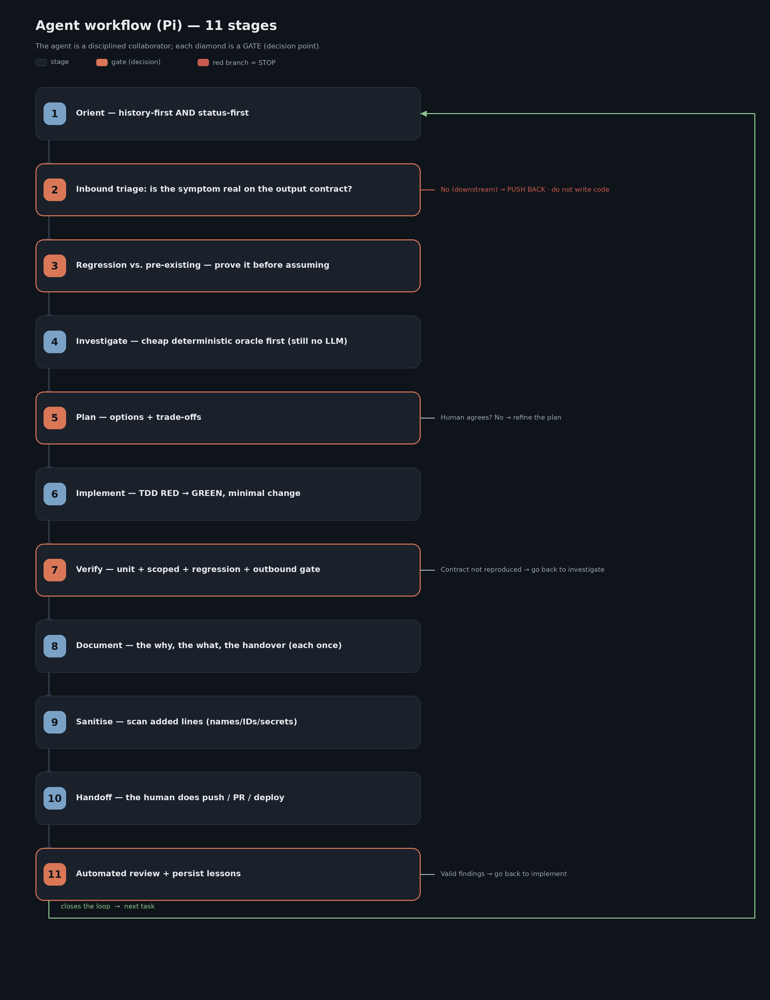

# Pi — Guía de presentación (curso en tres partes)

> 🇬🇧 English: [`SPEAKER_GUIDE.md`](./SPEAKER_GUIDE.md). Presentación (en inglés):
> [`presentation/Pi_Presentation.pptx`](./presentation/) (37 diapositivas; se regenera con
> [`presentation/build_pptx_pi.py`](./presentation/build_pptx_pi.py)).

> Guía narrativa para el curso/taller. Está escrita para el **ponente**: cada sección corresponde a un bloque de
> diapositivas e incluye la historia que contar, los puntos clave y una frase de cierre lista para la
> diapositiva 🗣️. Público: **técnico / desarrolladores**. Es el **volumen Pi** de la serie, después del volumen de
> Claude Code (`claude_code_ml_engineer`) y el de Cursor (`cursor_code_ml_engineer`), con el de GitHub Copilot
> (`copilot_code_ml_engineer`) a continuación. Misma estructura y misma numeración de secciones.
>
> La presentación es **una sola** con **tres partes diferenciadas**:
> - **Parte 1 — Pi:** la herramienta, un agente minimalista para terminal: lo que trae y lo que deliberadamente
>   te deja a ti.
> - **Parte 2 — La metodología:** cómo se trabaja de verdad con un agente en producción. Es **agnóstica de la
>   herramienta**: se demuestra con Pi y nació en Claude Code (la sección 10 es la transferencia).
> - **Parte 3 — El grafo de conocimiento de tickets:** el mismo caso completo construido con **graphify** que en
>   los otros volúmenes; la skill `kg` funciona en Pi sin cambios y `kg-refresh` tiene una advertencia honesta.
>
> El detalle de implementación (configuración, código para copiar) está en [`GUIA_TECNICA.md`](./GUIA_TECNICA.md)
> y en [`examples/`](./examples/). La carpeta [`docs/`](./docs/) es material de referencia de una instalación
> real donde la metodología se aplica a diario (saneado y seudonimizado). **Demos en directo por diapositiva:**
> [`DEMO_RUNBOOK_ES.md`](./DEMO_RUNBOOK_ES.md).
>
> **Nota de verificación:** cada afirmación sobre Pi sale de
> [`docs/research/PI_FINDINGS_2026-10-17.md`](./docs/research/PI_FINDINGS_2026-10-17.md), verificado el
> **2026-10-17 contra Pi 1.3.0** (documentación en <https://pi.dev/docs/latest>, más una instalación local). Lo
> marcado **[TESTED]** se ejecutó a mano; **[3rd-party]** es un paquete de la comunidad, sin probar; **NOT
> DOCUMENTED** significa que no hay fuente. Pi avanza rápido: vuelve a comprobar antes de dar el curso.
>
> **Actualización 2026-11-06 — Pi 1.5.0:** el delta desde la 1.3.0 (1.4.0 y 1.5.0) está en
> [`docs/research/PI_UPDATE_2026-11-06.md`](./docs/research/PI_UPDATE_2026-11-06.md); la puerta de git y un
> proveedor local en `models.json` se volvieron a ejecutar en la 1.5.0. Novedad de esta revisión: **la
> diapositiva 6, modelos locales en una GPU de 4 GB**.

---

## Índice

**Parte 1 — Pi**

0. [Qué es Pi (encuadre)](#0-qué-es-pi) — diapositiva 1
1. [Instalación, autenticación, modos y modelos](#1-instalación-autenticación-modos-y-modelos) — diapositivas 3–6 (incluye modelos locales)
2. [Memoria, permisos y sesiones](#2-memoria-permisos-y-sesiones) — diapositivas 7–10
3. [Contexto: ventana, compactación y prompt caching](#3-contexto) — diapositivas 11–13
4. [MCP — integrado desde la 0.99](#4-mcp) — diapositiva 14
5. [Skills, plantillas de prompt y paquetes](#5-skills-plantillas-de-prompt-y-paquetes) — diapositiva 15
6. [Subagentes (no integrados)](#6-subagentes) — diapositivas 16–18
7. [Extensiones y automatización](#7-extensiones-y-automatización) — diapositivas 19–20

**Parte 2 — La metodología (agnóstica)**

8. [La metodología: principio, flujo, puerta de cinco comprobaciones](#8-la-metodología) — diapositivas 21–24
9. [Las herramientas del método: CodeGraph, Serena, GSD…](#9-las-herramientas-del-método) — diapositivas 25–29
10. [Transferir la metodología: de Claude Code a Pi](#10-transferir-la-metodología) — diapositiva 30
11. [Sincronización de máquinas (tarball + S3)](#11-sincronización-de-máquinas) — diapositiva 31

**Parte 3 — El grafo de conocimiento de tickets (graphify)**

12. [El grafo de conocimiento de tickets](#12-el-grafo-de-conocimiento-de-tickets) — diapositivas 32–36
13. [Cierre](#13-cierre) — diapositiva 37

---

# PARTE 1 — Pi

## 0. Qué es Pi

*Diapositivas 1–2 (portada, agenda).*

**Historia:** Pi es un **agente de programación minimalista para terminal**: "AI agent toolkit: unified LLM API,
agent loop, TUI, coding agent CLI". Empezó como `badlogic/pi-mono` (Mario Zechner) y ahora vive en
**`earendil-works/pi`**, mantenido por Earendil Inc., con licencia MIT. La versión 1.0 salió el 2026-10-01; este
curso se investigó sobre la **1.3.0** (2026-10-15) y se actualizó para la **1.5.0** (2026-11-02).

El encuadre que hace que toda la Parte 1 encaje es la propia sección de la web **"What we didn't build"**: sin
popups de permisos, sin subagentes, sin modo plan y, hasta hace poco, sin MCP. Pi trae un núcleo pequeño (cuatro
herramientas: `read`, `bash`, `edit`, `write`; un prompt de sistema corto) y una **API de extensiones en
TypeScript** para todo lo demás. Donde Claude Code y Cursor te dan una función, Pi a menudo te da un mecanismo.

**Por qué este volumen importa para la metodología:** el método siempre quiso ser agnóstico de la herramienta.
Pi es la prueba más dura hasta ahora: sin prompts de aprobación y sin subagentes integrados, la *política* tiene
que estar escrita y la tienes que hacer cumplir tú. Si el método sobrevive a Pi, sobrevive a cualquier cosa.

**Agenda (diapositiva 2):** la Parte 1 son siete secciones (instalación → memoria/permisos/sesiones → contexto →
MCP → skills → subagentes → extensiones/automatización); la Parte 2 son cuatro (flujo, herramientas,
transferencia, operaciones); la Parte 3 es el grafo de tickets y el cierre.

🗣️ *"Pi es lo que obtienes cuando alguien construye el bucle del agente y se niega a meterle nada más: así que más te vale saber lo que quieres."*

---

## 1. Instalación, autenticación, modos y modelos

*Diapositivas 3 (separador de la Parte 1), 4 (instalación y autenticación), 5 (modos, modelos, razonamiento),
6 (modelos locales en una GPU de 4 GB).* Referencia:
[`GUIA_TECNICA.md` §1](./GUIA_TECNICA.md#1-instalación-y-cli). Ejemplo:
[`examples/local-models/`](./examples/local-models/README_ES.md).

**Historia (diapositiva 4):** instalar es una línea; iniciar sesión es un comando. Enseña las dos cosas y dedica
el tiempo a la trampa del nombre, porque los tutoriales antiguos van a confundir a tu público.

```bash
curl -fsSL https://pi.dev/install.sh | sh                          # macOS/Linux; fija dependencias; luego: pi update
npm install -g --ignore-scripts @earendil-works/pi-coding-agent    # Node >= 22.19
pi --version                                                        # [TESTED] -> 1.5.0
cd tu-proyecto && pi                                                # luego /login y /model
```

- **Autenticación:** `/login` elige un proveedor (suscripción OAuth o clave API) y lo guarda en
  `~/.pi/agent/auth.json`. Para CI, variables de entorno (`ANTHROPIC_API_KEY`, `OPENAI_API_KEY`,
  `GEMINI_API_KEY`, `OPENROUTER_API_KEY`, … unos 40 proveedores). Precedencia: `--api-key` → `auth.json` →
  `models.json` → entorno.
- **Bedrock / Vertex / Azure / local:** credenciales AWS del entorno para Bedrock; llama.cpp con `/llama`;
  Ollama, LM Studio y vLLM con `~/.pi/agent/models.json`. La diapositiva 6 cuenta toda la historia local.
- **¿Qué suscripciones funcionan con `/login`?** La documentación **no publica ninguna lista**: NOT DOCUMENTED.
  Dilo tal cual.
- **Trampa del nombre:** `@mariozechner/pi-coding-agent` está obsoleto en favor de
  `@earendil-works/pi-coding-agent`; el repo redirige. Las extensiones importan los tipos desde el nuevo scope. El
  binario sigue siendo `pi`.

**Historia (diapositiva 5): cinco formas de manejarlo.** La TUI es para ti; todo lo demás es para scripts y
programas.

| Modo | Comando | Uso |
|---|---|---|
| TUI interactiva | `pi` | personas; `!cmd` ejecuta en la shell y envía la salida al modelo, `!!cmd` no la envía |
| Print | `pi -p "…"` | scripts; código de salida distinto de cero en error / aborto / longitud |
| Eventos JSON | `pi --mode json "…"` | herramientas que quieren el flujo de eventos |
| RPC | `pi --mode rpc` | integración de larga duración (JSONL por stdin/stdout) |
| SDK | `createAgentSession()` | dentro del proceso, Node/Bun |

**Modelos y razonamiento:** `/model`, `Ctrl+L`, `Ctrl+P` para rotar, `--model sonnet:high` en la CLI. Niveles de
razonamiento `off | minimal | low | medium | high | xhigh | max`, ajustados a lo que soporta cada modelo; por
defecto `medium`. Las sesiones registran los cambios de modelo y razonamiento y los restauran al reanudar.

🗣️ *"Un binario, cinco superficies. Aprende la TUI para ti y `-p` para todo lo que vayas a automatizar."*

### Diapositiva 6 — Modelos locales en una GPU de 4 GB

**Historia:** "¿Puedo ejecutar esto en mi propia GPU?" es la primera pregunta que hace cualquier público. Con
4 GB de VRAM la respuesta honesta es *sí, para trabajo acotado*, y Pi es el agente con el que mejor funciona.

- **Dos rutas.** El **proveedor de llama.cpp integrado**: arrancas un *router* de llama.cpp (sin `-m`),
  `/login llama.cpp`, y luego `/llama` carga, descarga de memoria y baja GGUFs de Hugging Face desde dentro de
  Pi. O **`models.json`** con `api: "openai-completions"` para Ollama, LM Studio, vLLM o SGLang.
- **Qué cabe en 4 GB:** **Qwen3.5-4B** en `IQ4_XS` (~2,7 GB) o `Q4_K_M` (~3,0 GB), sin proyector de visión, 16–32 K
  de contexto, caché KV en q8_0. Los modelos de 7–9 B necesitan 8 GB para tener un contexto usable.
- **Por qué Pi:** medido en la 1.5.0, una petición con `--tools read,bash,edit,write --no-mcp` lleva ~2,3 K
  caracteres de prompt de sistema y cuatro esquemas de herramienta (~2,8 K): unos **1,3 K tokens** de coste fijo.
  Los agentes con prompts largos y decenas de herramientas (Cline, Roo, OpenCode) dejan poco espacio a un modelo
  de 4 B y lo confunden. Aider es la alternativa fuerte: no necesita llamadas a herramientas nativas.
- **Los tres ajustes que importan:** `contextWindow` = el contexto real del servidor (si no, la compactación no
  salta nunca y el servidor trunca); `compaction.modelOverrides` por modelo (~6 K de reserva, ~8 K recientes);
  razonamiento `off` para ediciones rápidas (`modelThinkingLevels`).
- **Qué servidor:** llama.cpp (control, nativo en Pi) › Ollama / LM Studio (lo más fácil; sube el contexto por
  defecto de Ollama) › vLLM (pensado para GPUs grandes, no para 4 GB).
- **Ajusta expectativas:** un modelo de 4 B lee, ejecuta comandos y hace ediciones pequeñas y bien especificadas.
  No planifica cambios en varios ficheros. Ten un modelo en la nube a un `Ctrl+P`.

Demo sin GPU: `bash examples/local-models/verify/run.sh`: un "modelo" compatible con OpenAI y guionizado pide
`git push`, la puerta lo bloquea y el script imprime exactamente lo que Pi envió.

🗣️ *"Un modelo pequeño necesita un agente pequeño. El prompt de Pi son unos 1,3 K tokens: ese es todo el truco."*

---

## 2. Memoria, permisos y sesiones

*Diapositivas 7 (AGENTS.md), 8 (SYSTEM.md + sin memoria automática), 9 (permisos), 10 (sesiones).* Referencia:
[`GUIA_TECNICA.md` §2](./GUIA_TECNICA.md#2-memoria), [§3](./GUIA_TECNICA.md#3-permisos),
[§4](./GUIA_TECNICA.md#4-sesiones). Ejemplos: [`examples/agents-md/`](./examples/agents-md/),
[`examples/permissions/`](./examples/permissions/).

### Diapositiva 7 — `AGENTS.md`: hacia arriba, un fichero por directorio

**Historia:** las reglas de los ficheros de contexto son la mayor diferencia respecto a los otros dos volúmenes,
y la que más probablemente pille a alguien con experiencia en Claude Code o Cursor.

- Pi carga el fichero **global** (`~/.pi/agent/`) y luego **cada directorio ancestro** desde `/` hasta el cwd.
  **No** busca en subdirectorios por debajo del cwd: no hay descubrimiento anidado donde gana el más específico.
- **Un fichero por directorio**: el primero que encuentra en el orden
  `AGENTS.override.md > AGENTS.md > AGENTS.MD > CLAUDE.md > CLAUDE.MD`. Un directorio con `AGENTS.md` y
  `CLAUDE.md` aporta **solo** `AGENTS.md`.
- **Sin reglas con ámbito** (ni globs `.mdc` ni `.claude/rules/`), y los includes `@path` dentro de `AGENTS.md`
  son **NOT DOCUMENTED**: trata el fichero como texto plano que contiene punteros.
- Pi **no** lee `~/.claude/CLAUDE.md`. Usa un enlace simbólico o cópialo si quieres el mismo fichero global.
- Los ficheros de contexto se cargan **sin importar la confianza del proyecto**; `-nc` / `--no-context-files`
  los desactiva.

**El patrón de dos niveles sigue funcionando**: siempre fue "punteros, no copias", ficheros pequeños siempre
cargados que apuntan a `data/changes/**` y se leen bajo demanda. Lo que pierdes es el fichero por subcarpeta; lo
que sustituye a las reglas con ámbito es una **skill cuya descripción nombra las rutas a las que aplica**, o una
extensión.

### Diapositiva 8 — `SYSTEM.md`, `APPEND_SYSTEM.md` y sin memoria automática

- `SYSTEM.md` **sustituye** el prompt de sistema por defecto de Pi; `APPEND_SYSTEM.md` **lo amplía**. En
  `~/.pi/agent/` o en `.pi/`; gana el fichero del proyecto de confianza, no se combinan. CLI: `--system-prompt`,
  `--append-system-prompt`.
- **Sin memoria integrada entre sesiones.** La web deja la memoria para las extensiones. Hay paquetes
  [3rd-party] (`pi-memory`, `pi-observational-memory`, …), sin probar. La respuesta de la metodología es la de
  siempre: registros de solo escritura (`STATUS.md`, `FOLLOWUPS.md`, `SHARP_EDGES.md`), y Pi añade
  `PI_SESSION_FILE` para el rastro en bruto.

### Diapositiva 9 — Permisos: ninguno, por diseño

Cita la web: **"No permission popups — Run in a container, or build your own confirmation flow with
extensions."** Pi lee, edita y ejecuta con los permisos de tu cuenta y no pregunta.

- La **confianza del proyecto** (`/trust`, guardada en `~/.pi/agent/trust.json`) solo decide si se cargan los
  recursos `.pi/` de una carpeta (ajustes, `mcp.json`, extensiones, skills, prompts). **No** es un sandbox. Los
  modos print, JSON y RPC no pueden preguntar, así que con el valor por defecto `"ask"` **se saltan** los recursos
  del proyecto salvo que pases `--approve`.
- **Aislamiento:** Docker (monta solo el espacio de trabajo; nunca montes el `~/.pi/agent` del host), Docker
  Sandboxes, NVIDIA OpenShell, la extensión de micro-VM Gondolin.
- **Restricción estática por nombre de herramienta:** `--tools read,grep,find,ls`, `--exclude-tools`,
  `defaultTools`, MCP `exposure: "hidden"`.
- **Puertas de contenido = extensiones:** ejemplos incluidos `permission-gate.ts` (bloquea por defecto cuando no
  hay UI), `protected-paths.ts`, `confirm-destructive.ts` (el ejemplo `sandbox/` se eliminó en la 1.5.0). La
  sección 7 construye una.
- **Honestidad:** las puertas con expresiones regulares se pueden saltar (`sh -c`, alias, scripts), la misma
  advertencia que con el hook de Cursor. Para garantías reales, aislamiento a nivel de sistema operativo.

### Diapositiva 10 — Las sesiones son un árbol

- Se guardan como **árboles** JSONL (`id` / `parentId`, cabecera v3) en
  `~/.pi/agent/sessions/--<cwd>--/<timestamp>_<id>.jsonl`.
- `pi -c` reanuda la última de este cwd; `pi -r` / `/resume` abre un selector; `--no-session` es efímera.
- `/tree` se mueve dentro del mismo fichero (y puede resumir la rama que dejas); `/fork` empieza una sesión nueva
  desde un mensaje anterior del usuario; `/clone` copia la rama activa; Esc-Esc equivale a `/tree` por defecto.
- `/export` (HTML/JSONL), `pi --export`, `/share` (gist privado con `gh`, o un artefacto de Radius).
- Las herramientas de shell reciben `PI_SESSION_ID`, `PI_SESSION_FILE`, `PI_MODEL`: los scripts pueden citar la
  sesión exacta.

🗣️ *"Pi te da mecanismos, no una política. 'La persona es dueña de las acciones externas' ahora te toca hacerlo cumplir a ti: en un fichero, en una extensión y en un contenedor."*

---

## 3. Contexto

*Diapositivas 11 (ventana + compactación), 12 (prompt caching), 13 (palancas para un contexto ligero).*
Referencia: [`GUIA_TECNICA.md` §5](./GUIA_TECNICA.md#5-ventana-de-contexto),
[§6](./GUIA_TECNICA.md#6-prompt-caching). Ejemplos: [`examples/context/`](./examples/context/),
[`examples/prompt-caching/`](./examples/prompt-caching/).

### Diapositiva 11 — Ventana de contexto y compactación

**Qué la llena:** un prompt de sistema deliberadamente pequeño; la cadena de `AGENTS.md` (la controlas tú); las
skills (solo nombre + descripción + ruta hasta que se usan); MCP (en el codemode por defecto, solo un resumen de
una línea por servidor); y después la conversación, que crece.

**Compactación:** la compactación automática salta cuando `contextTokens > contextWindow - reserveTokens`,
también entre tandas de herramientas, con un único compactar-y-reintentar si se desborda. `/compact
[instrucciones]` la hace a mano y las instrucciones orientan el resumen. Ajustes: `compaction.enabled` (true),
`compaction.reserveTokens` (16384), `compaction.keepRecentTokens` (20000); desde la 1.4.0, `reserveTokens` solo
decide *cuándo* empieza la compactación y el resumen usa el límite de salida del modelo. El resumen es
estructurado (Goal / Constraints / Progress / Key Decisions / Next Steps / Critical Context) y **las entradas
originales se quedan en el fichero JSONL**. Las extensiones pueden cancelar o aportar el resumen
(`session_before_compact`).

### Diapositiva 12 — Prompt caching: automático, con mandos

La economía de la API de Anthropic es la misma que en los otros volúmenes (escritura 1,25×, 2× para 1 h; lectura
0,1×), y la demo ejecutable [`examples/prompt-caching/cache_demo.py`](./examples/prompt-caching/cache_demo.py)
enseña el mecanismo contra la API. Lo que cambia: **Pi pone los marcadores por ti** (`cache_control` en el prompt
de sistema, en la última definición de herramienta y en el último mensaje; `prompt_cache_key` / afinidad de
sesión en proveedores tipo OpenAI). Y, a diferencia de Cursor, expone mandos:

- `PI_CACHE_RETENTION=long`: retención extendida donde se soporta.
- `cacheWarming: "off" | "streaming" | "idle"` (por defecto `"streaming"`, solo global): mantiene las cachés
  calientes cuando el ahorro estimado es ≥ 0,05 $.
- `showCacheMissNotices: true`: avisos de fallos de caché, calentamientos y uso en compactaciones; `/session`
  enseña la próxima decisión de calentamiento.
- Decisiones de diseño que protegen la caché: los cambios de prompt/herramientas a mitad de conversación se
  **añaden** como deltas. Lo que la rompe: **cambiar de modelo**; y las peticiones de compactación no escriben en
  la caché.

### Diapositiva 13 — Las palancas propias de Pi

Cuatro herramientas por defecto; skills perezosas; codemode de MCP (los scripts filtran salidas grandes antes de
que las vea el modelo); el texto de MCP por encima de 20 KB se trunca por el medio y el texto completo se guarda
en un fichero temporal; `/tree` y `/fork` para tareas laterales; `--no-context-files`, `--no-skills`,
`--no-extensions` para ejecuciones mínimas.

🗣️ *"Pi arranca más ligero que cualquier otro de esta serie; y aun así, lo que lo mantiene ligero es el orden de herramientas de la metodología."*

---

## 4. MCP

*Diapositiva 14.* Referencia: [`GUIA_TECNICA.md` §7](./GUIA_TECNICA.md#7-mcp). Ejemplo:
[`examples/mcp/`](./examples/mcp/).

**Historia:** empieza por la trampa: buena parte de la web todavía dice "Pi no tiene MCP". Esa fue la postura de
Pi hasta la 0.87.x; **MCP nativo más codemode llegó en la 0.99.0 (2026-09-29)** y se consolidó en la 1.0.

- Configuración: `~/.pi/agent/mcp.json` (usuario) y `.pi/mcp.json` (proyecto, **solo de confianza**). La forma
  `mcpServers` coincide con Claude Code y Cursor: copia tus entradas actuales.
- Transportes: stdio y HTTP con streaming. **SSE se rechaza.** Las herramientas se llaman `mcp__servidor__herramienta`.
- CLI: `pi mcp add <nombre> -- <cmd> [args]`, `pi mcp add <nombre> --url …`, `pi mcp list` (sale con 1 si hay
  fallos), `pi mcp login|logout`, `/mcp` en la TUI.
- **Modos de exposición, la parte que importa para la metodología:**
  - `codemode` (**por defecto**): no se declaran como herramientas; solo se pueden llamar desde scripts JavaScript
    de codemode.
  - `deferred`: se cargan con `tool_search`.
  - `direct`: se declaran como una herramienta integrada.
  - `hidden`: inalcanzables.
  - `toolExposure` lo fija por herramienta, con globs.
- **Por qué importa:** el método quiere que el agente use `codegraph_explore` y `find_referencing_symbols` de
  Serena *sin que se lo pidan*. Así que esas dos van en `direct`; Playwright y Context7 se quedan en `deferred`.
- Toda llamada MCP, también desde codemode, pasa por el manejador de extensiones `tool_call`, así que las puertas
  de la sección 7 aplican.
- *(1.5.0)* `pi mcp --help` ya muestra `add`/`remove`; los servidores OAuth usan registro de cliente automático
  por defecto (`oauth.clientRegistration: "auto"`); los argumentos de las herramientas MCP reciben la misma
  coerción que las integradas.

🗣️ *"Pi ya tiene MCP. El truco es hacer visibles las herramientas correctas: codemode por defecto, `direct` para las que necesita tu método."*

---

## 5. Skills, plantillas de prompt y paquetes

*Diapositiva 15.* Referencia: [`GUIA_TECNICA.md` §8](./GUIA_TECNICA.md#8-skills-y-paquetes). Ejemplo:
[`examples/skills-plugins/`](./examples/skills-plugins/) (con `day`, `atlassian`, `evidence`, `preview`;
herramientas en [`examples/methodology/tools/`](./examples/methodology/tools/)). Activas en este repo:
[`.pi/skills/`](./.pi/skills/) (`audit`, `audit-python`, `deploy-staging`) contra [`ex_npm/`](./ex_npm/),
[`ex_app/`](./ex_app/), [`ex_staging/`](./ex_staging/).

- Pi implementa el estándar **Agent Skills**: un directorio con `SKILL.md` (`name` + `description`; la
  descripción dirige la carga automática). Ubicaciones: `~/.pi/agent/skills/`, `.pi/skills/` (de confianza),
  `~/.agents/skills/`, `.agents/skills/`, el ajuste `skills`, `--skill <ruta>`, paquetes.
- **Se invoca con `/skill:nombre [args]`, no con `/nombre`.** El modelo también carga una skill por su cuenta
  leyendo su `SKILL.md` cuando la descripción encaja.
- **Interoperabilidad:** las claves de frontmatter desconocidas se ignoran en silencio; la clave `trigger:`
  específica de Claude cargó bien [TESTED]. `.claude/skills` **no** se descubre solo, pero se puede listar en los
  ajustes. Medido: apuntar `"skills"` a todo `~/.claude/skills` cargó ~85 skills y volcó todas sus descripciones
  en el prompt; lista los directorios que quieras uno a uno. Colisiones: gana la primera.
- **Plantillas de prompt:** `~/.pi/agent/prompts/<nombre>.md` o `.pi/prompts/<nombre>.md` → `/<nombre>`, con
  `$1`, `$@`, `$ARGUMENTS`. Es lo más parecido a los slash commands de Claude Code.
- **Paquetes:** `pi install npm:… | git:… | ./local` (`-l` para el ámbito del proyecto), `pi list`, `pi remove`,
  `pi config`. Galería: <https://pi.dev/packages> (5.354 paquetes el 2026-10-17).

🗣️ *"El mismo `SKILL.md` que en Claude Code y Cursor. Lo que cambia es una palabra: `/skill:day start`."*

---

## 6. Subagentes

*Diapositivas 16 (no integrados), 17 (subagente de solo lectura), 18 (decisión).* Referencia:
[`GUIA_TECNICA.md` §9](./GUIA_TECNICA.md#9-subagentes). Ejemplo: [`examples/subagents/`](./examples/subagents/).

### Diapositiva 16 — No integrados, a propósito

Web: **"No sub-agents — Spawn Pi instances via tmux, or build your own with extensions, or install a package."**
Tres opciones:

1. **Extensión de ejemplo oficial** `examples/extensions/subagent/`: cada subagente es un proceso `pi` aparte con
   contexto aislado; modos individual, paralelo (máx. 8, 4 a la vez) y cadena (`{previous}`). Los ficheros de
   agente son Markdown con `name`, `description`, `tools`, `model` en `~/.pi/agent/agents/` (los del proyecto en
   `.pi/agents/` solo con `agentScope: "project" | "both"`). Ejemplos `scout`, `planner`, `reviewer`, `worker`;
   prompts de flujo `/implement`, `/scout-and-plan`, `/implement-and-review`.
2. **[3rd-party]** `pi-subagents`, sin probar.
3. **tmux** o procesos `pi -p` / RPC en paralelo.

### Diapositiva 17 — Un subagente de solo lectura, de dos formas

- **Fichero de agente:** `tools: read, grep, find, ls`, sin `bash`, `edit` ni `write`. Ojo: el `scout` que viene
  incluido **sí** lleva `bash`.
- **Proceso hijo desechable** con flags documentados:
  `pi -p --no-session --tools read,grep,find,ls "…" </dev/null`.
- El procedimiento `refactor-scout` (CodeGraph → Serena → grep) de los otros volúmenes está empaquetado como
  fichero de agente en [`examples/subagents/`](./examples/subagents/).

### Diapositiva 18 — La decisión

| | Extensión de subagentes | `pi` / RPC en paralelo |
|---|---|---|
| Contexto | Aislado; devuelve un resultado | Sesión completa por proceso |
| Comunicación | Resultado → sesión principal | Ninguna |
| Orquestación | individual · paralelo · cadena | tmux, tu script, `RpcClient` |
| Úsalo para | Tareas laterales: explorar, revisar | Trabajo largo o particionado |

**Sin Agent Teams ni bandeja compartida** (NOT DOCUMENTED). Particiona por rama/fichero antes de lanzar procesos en
paralelo; integra la persona o la sesión principal.

🗣️ *"Solo lectura es una lista de herramientas, no una promesa. Quítale las herramientas de escritura y el subagente no te puede sorprender."*

---

## 7. Extensiones y automatización

*Diapositivas 19 (extensiones como hooks), 20 (automatización).* Referencia:
[`GUIA_TECNICA.md` §10](./GUIA_TECNICA.md#10-extensiones-hooks),
[§11](./GUIA_TECNICA.md#11-automatización). Ejemplos: [`examples/extensions/`](./examples/extensions/),
[`examples/automation/`](./examples/automation/). Activa: [`.pi/extensions/`](./.pi/extensions/).

### Diapositiva 19 — Las extensiones son los hooks

Pi no tiene `hooks.json`. Los hooks son **extensiones en TypeScript**: `export default function (pi:
ExtensionAPI)`, cargadas con `jiti` (sin compilar), recargadas en caliente con `/reload`, desde
`~/.pi/agent/extensions/` o `.pi/extensions/` (de confianza). Los eventos incluyen `tool_call` (puede modificar la
entrada o bloquear), `tool_result`, `user_bash`, `before_agent_start` y la familia `session_*`. Devuelve `{ block:
true, reason }` desde `tool_call` para bloquear, y eso incluye llamadas anidadas, scripts de codemode y MCP. Un
manejador que lanza una excepción **bloquea la herramienta** (a prueba de fallos).

**La que probamos:** `block-external-git.ts` bloquea `git push`, `gh pr create|merge|…`, `gh release` y merges
desde `origin/` o `upstream/`. Probada en la 1.3.0 y **vuelta a probar en la 1.5.0** con un servidor falso
compatible con OpenAI que guioniza dos llamadas a bash: con la extensión, el push quedó bloqueado y `echo
allowed-ok` se ejecutó igualmente; **en la ejecución de control sin ella, el push se ejecutó de verdad**: eso es
lo que demuestra la puerta, no el entorno. Instálala **globalmente** (`~/.pi/agent/extensions/`): las extensiones
globales no dependen de la confianza y un repo no las puede quitar. Recuerda que las extensiones se ejecutan
**dentro del proceso con todos los permisos del sistema**: léelas antes de instalarlas.

### Diapositiva 20 — Automatización y cuatro trampas

- **`</dev/null` [TESTED]:** cuando stdin es una tubería que no es TTY y nunca se cierra (runners de CI, arneses
  de agentes), `pi -p` espera el EOF y parece colgado.
- **`--approve`:** print/JSON/RPC no pueden mostrar la pregunta de confianza; los recursos `.pi/` del proyecto se
  saltan en silencio.
- **Código de salida del modo JSON:** una ejecución fallida no sale por sí sola con un código distinto de cero:
  revisa los eventos.
- **El SDK no trae MCP por defecto:** añade `createMcpExtension()` (y codemode/tool-search) con
  `DefaultResourceLoader({ extensionFactories })` y llama a `session.bindExtensions()`.
- **CI:** **no hay GitHub Action oficial** (NOT DOCUMENTED). El patrón de
  [`examples/automation/`](./examples/automation/) instala un Pi con versión fijada y ejecuta
  `pi -p --no-session --approve --model anthropic/<id> "review the diff" </dev/null`; publicar los resultados es
  un paso posterior controlado por una persona. Ejecuciones deterministas: `PI_OFFLINE=1`,
  `PI_SKIP_VERSION_CHECK=1`, `PI_TELEMETRY=0`. Sin planificador integrado: cron, CI, systemd.

🗣️ *"Con `AGENTS.md` le pides que se porte bien; con una extensión lo garantizas. En Pi la garantía es TypeScript, y es tuya."*

---

# PARTE 2 — La metodología (agnóstica de la herramienta)

## 8. La metodología

*Diapositivas 21 (separador de la Parte 2), 22 (principio), 23 (flujo de 11 etapas), 24 (puerta de cinco
comprobaciones).* Referencia: [`GUIA_TECNICA.md` §12](./GUIA_TECNICA.md#12-metodología). Material:
[`examples/methodology/`](./examples/methodology/) (saneado).

**Historia:** herramientas sin método = caos rápido. Es la parte más valiosa del curso: cómo se trabaja de verdad
con un agente de programación en un proyecto en producción. Es la que usamos, en revisión constante. Y en Pi
importa **más**: sin prompts de aprobación y sin modo plan, el método es lo único que se interpone entre el
agente y un push sin revisar.

### Diapositiva 22 — El principio
> **El agente es un colaborador disciplinado, no un piloto automático. La autonomía se gana decisión a decisión,
> no se concede en bloque.** El agente se encarga de investigar, planificar, implementar, probar y documentar; la
> persona es dueña de las decisiones de seguir o parar, del alcance y de **toda acción externa** (push, PR,
> despliegue).

### Diapositiva 23 — El flujo de 11 etapas



1. **Orientarse** — primero la historia Y primero el estado (`/skill:kg` + `STATUS.md` + `git`/`gh`). En Pi,
   `AGENTS.md` apunta a los registros.
2. **Triaje de entrada** — ¿el síntoma es real en el **contrato de salida**? Si no → se rechaza, sin código.
3. **Regresión o preexistente** — reproducir contra el estado anterior.
4. **Investigar** — primero un **oráculo determinista**; el modelo se reserva para verificar.
5. **Planificar** — Pi **no tiene modo plan**: el plan es un **fichero** en `data/changes/<ticket>/` que la
   persona acepta (`/skill:methodology-plan` rellena la plantilla), o la extensión de ejemplo `plan-mode/`.
6. **Implementar** — TDD: ROJO (por el motivo correcto) → VERDE, cambio mínimo.
7. **Verificar** — unitarios + acotados + regresión + la **puerta de salida de cinco comprobaciones**
   (diapositiva 24).
8. **Documentar** — por qué + qué + traspaso + criterios de aceptación, cada cosa **una vez**.
9. **Sanear** — `/skill:sanitise-diff` revisa las **líneas añadidas**.
10. **Traspaso** — el agente **no** hace push/PR/despliegue; `block-external-git.ts` lo garantiza. Lo hace la persona.
11. **Revisión + persistencia** — los hallazgos de la revisión se triagean como los de una persona;
    `/skill:kg-refresh` si el grafo debe ver el nuevo ticket (ver la advertencia de la Parte 3); las lecciones,
    a `PLAYBOOK.md`.

> **¿Dónde está el coste?** Las herramientas dan hechos sin inferencia; el agente lee, razona y decide, y eso
> cuesta. El método **concentra** el coste: barato en 1–3 y 9, caro en 5–6–7. Tabla:
> [`examples/methodology/WORKFLOW.md`](./examples/methodology/WORKFLOW.md). Caso práctico:
> [`examples/methodology/REAL_EXAMPLE.md`](./examples/methodology/REAL_EXAMPLE.md): bug de QA "un campo sale vacío
> en la UI pero está en el PDF" → el contrato lo confirma → preexistente → un `_diag_pdf.py` determinista da la
> causa sin llamar al modelo → plan acordado → ROJO → arreglo estructural → verificado con el wrapper y dentro de
> la imagen desplegada → saneado → la persona hace el push.

### Diapositiva 24 — La puerta de salida son cinco comprobaciones

**(0)** canario del instrumento de medida contra un caso con respuesta conocida; **(1)** reproducir en la etapa
de salida real (el *wrapper*, no un `extract()` interno); **(2)** comprobar la **lista de miembros**, nunca un
total; **(3)** verificar dentro de la **imagen desplegada**; **(4)** **mirar** la salida renderizada.

Cinco maneras en que una puerta en verde no demuestra nada, todas reales: un **instrumento roto** (una sonda cuyo
propio `try/except` convierte errores en un `False` plausible para todos los casos); un **total que cuadra** (+1 y
−1 se anulan); una **puerta que no podía fallar** (un detector que salta en 0 de 190 documentos del corpus se lee
igual esté bien o roto); un **canario que nunca aplicó la perturbación real** (prueba sintética con 100 % de
recuperación, reconstrucción real <1 %); una **puerta estructural leída como semántica** (todo presente y
conectado mientras el 56 % de los nombres estaban mal).

🗣️ *"El modelo no se gana la confianza gratis: se la gana decisión a decisión, con pruebas; y en Pi no hay popup detrás del que esconderse."*

---

## 9. Las herramientas del método

*Diapositivas 25 (prevalencia), 26 (CodeGraph), 27 (Serena), 28 (GSD), 29 (oráculos, Playwright, Context7, kg).*
Referencia: [`GUIA_TECNICA.md` §13](./GUIA_TECNICA.md#13-las-herramientas-del-método). Detalle:
[`examples/methodology/tools.md`](./examples/methodology/tools.md),
[`examples/codegraph/`](./examples/codegraph/), [`examples/serena/`](./examples/serena/),
[`examples/gsd/`](./examples/gsd/).

### Diapositiva 25 — La precedencia: de barato a caro, de determinista a probabilístico

Pi no tiene reglas con ámbito, así que la regla vive en `AGENTS.md`: *"`codegraph_explore` primero (trata el
código que devuelve como ya leído); `find_referencing_symbols` de Serena antes de renombrar/borrar; grep/read solo
para literales."* Y solo funciona si esas herramientas son **visibles**: `toolExposure: direct`.

| Etapa | Herramienta |
|---|---|
| Orientarse (1) | `/skill:kg` · `STATUS.md` · `git` · `gh` |
| Navegar (4) | CodeGraph `codegraph_explore` (MCP, direct) |
| Comprobar refactor (4–6) | Serena `find_referencing_symbols` (MCP, direct) |
| Diagnosticar (4) | Oráculo determinista (`_diag_*.py`, parser, validador) |
| Entorno (4) | CLI de la nube con un perfil de solo lectura |
| Contrato (2, 7) | Playwright MCP (deferred) |
| Desplegado (7) | Docker: reproducir dentro de la imagen de ejecución |
| Solo al final (7) | La llamada al agente: para verificar, no para diagnosticar |

### Diapositiva 26 — CodeGraph en Pi: hazlo direct

Tree-sitter → índice SQLite (`.codegraph/`), local, sin claves API; una consulta devuelve código + rutas de
llamada + radio de impacto + marcas de cobertura de tests. **[TESTED]:** `pi mcp add codegraph -- codegraph serve
--path <repo> --mcp`, y luego `pi mcp list` imprimió `codegraph: connected, 1 tool (codemode, global) … tools:
codegraph_explore`, que es justo el punto: **codemode** es el valor por defecto, así que añade `toolExposure: {
"codegraph_explore": "direct" }`. No hay documentada ninguna variable tipo `${workspaceFolder}`: usa un `--path`
absoluto en `.pi/mcp.json`, o `cwd`. [3rd-party] `@henryqw/pi-codegraph` / `@vndv/pi-codegraph` lo exponen de forma
nativa (sin probar).

### Diapositiva 27 — Serena

Navegación semántica vía LSP: `find_symbol`, `get_symbols_overview`, `search_for_pattern` y sobre todo
`find_referencing_symbols`, que distingue `Invoice.process` de `Refund.process`, algo que el impacto plano de
CodeGraph no puede. **Los argumentos `uvx … serena start-mcp-server` están copiados de la guía de Cursor y no se
probaron en Pi**: dilo. Existe [3rd-party] `@bacnh85/pi-serena`, sin probar.

### Diapositiva 28 — GSD: solo Claude Code

GSD (discutir → planificar → ejecutar → verificar, subagentes `gsd-*`, `.planning/`) soporta oficialmente Claude
Code, OpenCode, Gemini y Codex: **no Pi**. [3rd-party] `pi-gsd` es un port no oficial, sin probar. No cargues
`~/.claude/skills/gsd-*` en Pi: cargan [TESTED] pero llaman a herramientas de Claude que Pi no tiene. El sustituto
en Pi: ficheros de fase en `data/changes/`, plantillas de prompt (`/plan-phase` → una plantilla) y la cadena
`/implement` del ejemplo de subagentes. **Honestidad:** el proyecto real tampoco usa GSD; el flujo de 11 etapas +
`data/changes/` encaja con arreglos por ticket en un servicio en producción.

### Diapositiva 29 — Oráculos, Playwright, Context7, kg

Los oráculos caseros (`_diag_*.py`) son código suelto que el agente ejecuta con bash: la respuesta barata y
reproducible. Playwright reproduce el síntoma donde lo ve el consumidor; Context7 da documentación viva de
librerías. Ambos con `"exposure": "deferred"` (se cargan con `tool_search` cuando hacen falta). Runbook de
instalación y prueba rápida:
[`docs/ai-agents-code-methodology/AGENT_SETUP_TOOLS.md`](./docs/ai-agents-code-methodology/AGENT_SETUP_TOOLS.md).

| # | Herramienta | Prueba mínima en Pi |
|---|---|---|
| 1 | CodeGraph | `pi mcp list` muestra `codegraph: connected`; luego pide `codegraph_explore` sobre un símbolo conocido |
| 2 | Serena | `find_referencing_symbols` sobre un método conocido |
| 3 | Playwright | abrir `https://example.com` y leer el título |
| 4 | Context7 | documentación actual de una librería |
| 5 | kg | `/skill:kg explain <tema>` |

🗣️ *"La inversión clásica, meter al modelo a diagnosticar, es justo lo que evita este orden: el modelo verifica; los oráculos diagnostican."*

---

## 10. Transferir la metodología

*Diapositiva 30.* Referencia: [`GUIA_TECNICA.md` §14](./GUIA_TECNICA.md#14-transferir-la-metodología). Kit:
[`docs/ai-agents-code-methodology/PI_ADAPTATION.md`](./docs/ai-agents-code-methodology/PI_ADAPTATION.md) +
superficie lista para copiar [`docs/ai-agents-code-methodology/pi/`](./docs/ai-agents-code-methodology/pi/).

**Historia:** la prueba de que la Parte 2 es agnóstica: el tercer agente de la serie, y el que menos trae
integrado.

**Lo que viaja sin cambios:** planificar → acordar → implementar · verificar sobre el contrato del consumidor ·
resolver la clase general · rastro duradero · la persona es dueña de lo externo.

**Lo que cambia: la superficie.**

| Claude Code | Pi |
|---|---|
| `CLAUDE.md` (+ anidados, `@imports`) | `AGENTS.md` en el cwd + ancestros; uno por directorio; sin imports |
| `.claude/rules/` | nada: una skill por ámbito, o una extensión |
| Skills `~/.claude/skills/` | `~/.pi/agent/skills/` / `.pi/skills/`: mismo `SKILL.md`, se invoca `/skill:nombre` |
| Hooks + allowlist en `settings.local.json` | Extensión TypeScript (`tool_call` → bloquear) + contenedores + `--tools` |
| Modo plan | un fichero de plan que acepta la persona, o el ejemplo `plan-mode/` |
| Subagentes / Agent Teams | extensión de ejemplo de subagentes / procesos `pi -p`; sin Teams |
| `claude -p` | `pi -p … </dev/null` (`--approve` para los recursos del proyecto) |
| memoria automática | nada: registros de solo escritura |
| GSD | no soportado ([3rd-party] `pi-gsd`) |

**El kit:** `PI_ADAPTATION.md` más `pi/`: `AGENTS.md.example`, `mcp.json.example` (CodeGraph y Serena `direct`,
Playwright y Context7 `deferred`), `settings.json.example`, `extensions/block-external-git.ts` y las skills `day`,
`atlassian`, `evidence`, `preview`, `kg`, `kg-refresh` (más `methodology-plan`, `sanitise-diff`) con la invocación
cambiada a `/skill:nombre`. El paquete trae también las adaptaciones a Cursor y Copilot: la disciplina llega a
todos los agentes.

**Advertencia de `kg-refresh`:** su paso de extracción semántica lanza subagentes, que Pi no tiene. Instala la
extensión de subagentes y adapta ese paso, o deja ese único paso en Claude Code.

🗣️ *"Claude Code → Cursor → Pi, y las puertas no se movieron. Las herramientas se sustituyen; la disciplina viaja."*

---

## 11. Sincronización de máquinas

*Diapositiva 31.* Referencia: [`GUIA_TECNICA.md` §15](./GUIA_TECNICA.md#15-sincronización-de-máquinas).
Material: [`examples/methodology/machine-sync.md`](./examples/methodology/machine-sync.md),
[`docs/synchro/`](./docs/synchro/), scripts en [`examples/methodology/s3-sync/`](./examples/methodology/s3-sync/).

**Historia:** los mismos principios aplicados a **operaciones**.

**A — Puesta en marcha: tarball + USB (asimétrica).** De salida = copia completa; de entrada = solo el delta de
`data/` (el código está en GitHub). Para Pi, añade **`~/.pi/agent/`** a la puesta en marcha (ajustes,
`mcp.json`, extensiones, skills, prompts, `AGENTS.md`), pero trata **`auth.json`, `mcp-auth.json` y `trust.json`
como secretos locales de la máquina**, igual que `.aws`. Vuelve a fijar el `--path` de CodeGraph en `mcp.json` en
el destino. Las sesiones viven en `~/.pi/agent/sessions/`. WSL no monta solo un USB conectado tarde; verifica la
copia byte a byte.

**B — El registro compartido sobre S3.** El tarball resuelve el *transporte*, no el *compartir*:
- Alcance estrecho, ampliado por fases revisadas (cada ampliación es un evento de seguridad: pon a prueba el
  escáner primero).
- **Escribir con sync, leer con un montaje de solo lectura**: el almacenamiento de objetos no tiene bloqueos.
- Simulación por defecto; `--delete` es una opción aparte; el borrado deliberado se hace con `delete.sh` y una
  lápida.
- **Protege las dos direcciones:** un pull te pisa a ti, un push pisa a tu compañero (11 líneas perdidas, sin
  error).
- **Un solo publicador** para el grafo derivado; "derivado" se decide por fichero, no por carpeta; las parejas se
  mueven juntas.
- ⚠️ La recuperación **caduca** (versiones no actuales a los 30 días).
- **La máquina tiene un rol:** `MACHINE_NAME` / `MACHINE_ROLE` → `IDENTITY.md` local de la máquina, y `AGENTS.md`
  apunta a él. El hábito es una rutina, no un párrafo: **`/skill:day start`** y **`/skill:day end`**.

🗣️ *"Cuando el rastro duradero pasa de una máquina a un equipo, el agente tiene que saber en qué máquina está antes de actuar."*

---

# PARTE 3 — El grafo de conocimiento de tickets (graphify)

## 12. El grafo de conocimiento de tickets

*Diapositivas 32 (separador), 33 (12a), 34 (12b), 35 (12c), 36 (12d).* Referencia:
[`GUIA_TECNICA.md` §16](./GUIA_TECNICA.md#16-grafo-de-conocimiento-de-tickets). Material:
[`docs/knowledge-graph/`](./docs/knowledge-graph/), resumen [`docs/KNOWLEDGE_GRAPH.md`](./docs/KNOWLEDGE_GRAPH.md).

**Historia:** el mismo caso completo que en los otros volúmenes. Si CodeGraph indexa el *código*, este grafo
indexa la **memoria del proyecto** (informes, aristas peligrosas, runbooks, notas de memoria) y responde *"¿qué
se rompió antes por aquí cerca?"* en una llamada, **sin LLM**. Construido con **graphify** (CodeGraph es solo la
analogía). La copia de este repo está **seudonimizada**: las claves de ticket y los nombres de cliente se
sustituyeron de forma consistente, así que la estructura está intacta.

### 12a. El problema y el diseño (diapositiva 33 — [`design.md`](./docs/knowledge-graph/design.md))
~540 ficheros de informes; un bug "nuevo" casi siempre tiene contexto previo que condiciona el arreglo. Un
[`manifest.txt`](./docs/knowledge-graph/manifest.txt) **comparable con diff** (~116 ficheros, ~196 k palabras),
exclusiones estrictas (binarios, traspasos repetidos, copias de viaje obsoletas). La fase 1 fue una prueba con una
decisión de mantener/ampliar/sustituir: graphify bastaba.

### 12b. El pipeline y las skills en Pi (diapositiva 34)
```
kg_refresh.sh prepare   # manifiesto -> preparar _corpus/ -> espacio temporal FUERA del repo
(extracción semántica)  # el único paso del agente: lanza SUBAGENTES en paralelo
kg_refresh.sh finalize  # artefactos a output/ + comprobación de fugas
```
- graphify respeta `.gitignore` y todo `data/` está ignorado → en el sitio encuentra 0 ficheros; de ahí el
  espacio temporal.
- **En Pi:** `/skill:kg` funciona sin cambios (scripts deterministas). El SKILL.md de `kg-refresh` carga
  [TESTED] y los extremos funcionan, pero el paso de extracción da por hecha la herramienta Agent de Claude Code;
  el soporte de graphify para Pi está **UNVERIFIED**. Reparto honesto: Pi para las consultas y los extremos; el
  paso semántico en Claude Code, o adaptado a la extensión de subagentes.

### 12c. La salida real (diapositiva 35 — [`GRAPH_REPORT.md`](./docs/knowledge-graph/output/GRAPH_REPORT.md))
**507 nodos · 672 aristas · 35 comunidades**; 92 % `EXTRACTED`, 7 % `INFERRED` (confianza media 0,7). Las
comunidades corresponden a zonas de peligro reales ("Letter-End & Run-in Titles", "Title Detection Failures",
"PDF Extractor Cascade"…); los nodos dios son una lista de incorporación gratis; las "conexiones sorprendentes"
sacan a la luz lecciones gemelas que nadie había enlazado a mano. La captura es
[`presentation/kg_graph.png`](./presentation/kg_graph.png), recapturada del `graph.html` seudonimizado.

### 12d. Uso y enganche (diapositiva 36)
```bash
kg_query.sh explain <ticket|tema>    # vecinos  <- lo más habitual
kg_query.sh path <A> <B>             # camino más corto
kg_query.sh find <subcadena>         # nombre exacto del nodo
# en Pi: /skill:kg explain <tema>
```
Se engancha en la **etapa 1 (Orientarse)**: la regla de "primero la historia" en `AGENTS.md`: `/skill:kg` antes
de hacer grep en `data/changes/`. Señala *qué leer*; no sustituye a leer. Las partes derivadas se reconstruyen
allí donde esté el corpus; los ficheros escritos a mano dentro del árbol (los nombres de comunidad curados) viajan
siempre.

> "Sin LLM en la consulta" no es "gratis": la inferencia cara se paga una vez en `kg-refresh`; cada consulta es
> un algoritmo determinista cuyo único coste es que el agente lea una salida corta. 🗣️ *"Razona una vez,
> recupera mil."*

🗣️ *"Un paso semántico al construir, cero LLM al consultar. El grafo es el mapa; el agente, el guía, sea cual sea el agente desde el que preguntes."*

---

## 13. Cierre

*Diapositiva 37.*

**Parte 1 — la herramienta:** Pi se instala en una línea y no trae casi nada, a propósito, y por eso mismo es el
mejor agente para un modelo local pequeño (llama.cpp integrado, ~1,3 K tokens de prompt fijo). `AGENTS.md` sube
por los directorios, `SYSTEM.md` es tuyo, no hay memoria automática y **no hay popups de permisos**:
contenedores, extensiones y `--tools` hacen cumplir la política. La caché es automática y con mandos reales; MCP
está integrado (codemode → `direct` para las herramientas de las que dependes); las skills son el mismo
`SKILL.md` invocado como `/skill:nombre`; los subagentes salen de una extensión o de procesos `pi` en paralelo; la
automatización es `-p </dev/null`, `--approve`, RPC y el SDK.

**Parte 2 — el método:** el flujo de 11 etapas con puertas deterministas y una puerta de salida de cinco
comprobaciones; el orden de herramientas de barato a caro; GSD se queda en Claude Code; la disciplina se
transfiere con `PI_ADAPTATION.md` + `pi/`; el rastro duradero pasa de transporte a compartir con identidad por
máquina.

**Parte 3 — el grafo:** 507 nodos, 672 aristas, 35 comunidades: primero la historia, sin LLM, consultable desde Pi
con la misma skill.

**La serie:** Claude Code → Cursor → Pi → **GitHub Copilot a continuación** (`copilot_code_ml_engineer`). Mismo
`SKILL.md`, mismas puertas, superficie distinta cada vez.

🗣️ *"De charlar con un asistente a un sistema, en cualquier agente. Pi simplemente te obliga a construir las piezas que los demás te dan hechas."*

**Referencias:** <https://pi.dev/docs/latest> · <https://github.com/earendil-works/pi> ·
<https://pi.dev/packages> · CodeGraph <https://github.com/colbymchenry/codegraph> · Serena
<https://github.com/oraios/serena> · graphify <https://graphify.net>. Verificado el 2026-10-17 con Pi 1.3.0; delta
revisado el 2026-11-06 con Pi 1.5.0. Pi avanza rápido: vuelve a comprobar antes de reutilizar.
