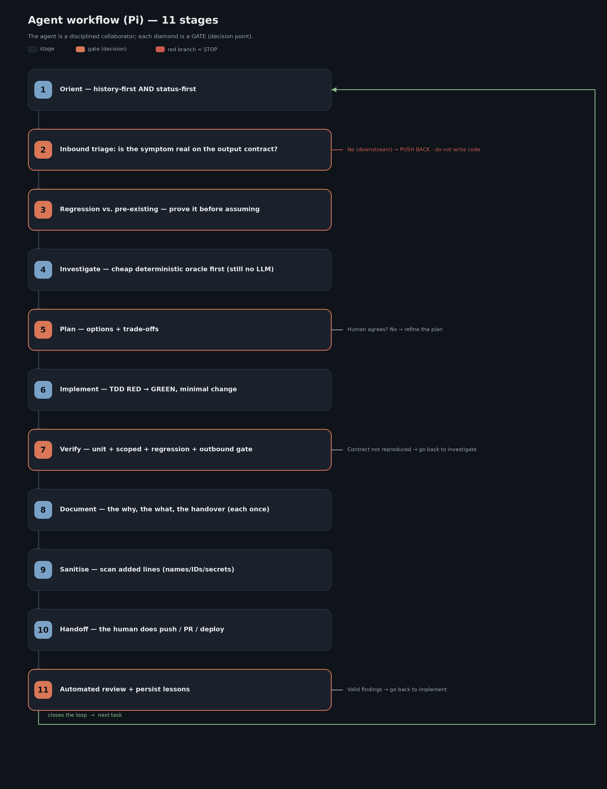

# Pi — Speaker guide (course in three parts)

> Deck: [`presentation/Pi_Presentation.pptx`](./presentation/) (36 slides; regenerate with
> [`presentation/build_pptx_pi.py`](./presentation/build_pptx_pi.py)).

> Narrative guide for the course/workshop. It is written for the **speaker**: each section maps to a
> block of slides in the deck and includes the story to tell, the key points, and a slide-ready closing
> line 🗣️. Audience: **technical / developers**. This is the **Pi volume** of the series — after the
> Claude Code volume (`claude_code_ml_engineer`) and the Cursor volume (`cursor_code_ml_engineer`), with
> the GitHub Copilot volume (`copilot_code_ml_engineer`) next. Same structure and section numbering.
>
> The deck is **a single presentation** with **three distinct parts**:
> - **Part 1 — Pi:** the tool — a minimal terminal agent, what it ships, and what it deliberately leaves to you.
> - **Part 2 — The methodology:** how you actually work with an agent in production. It is **tool-agnostic**
>   — demonstrated with Pi, born in Claude Code (section 10 is the transfer).
> - **Part 3 — The ticket knowledge graph:** the same complete case built with **graphify** as in the other
>   volumes — the `kg` skill works unchanged in Pi; `kg-refresh` has one honest caveat.
>
> The implementation detail (configs, copy-paste code) lives in
> [`TECHNICAL_GUIDE.md`](./TECHNICAL_GUIDE.md) and in [`examples/`](./examples/). The
> [`docs/`](./docs/) folder is reference material from a real installation where the methodology is applied
> daily (sanitised and pseudonymised). **Live demos by slide:** [`DEMO_RUNBOOK.md`](./DEMO_RUNBOOK.md).
>
> **Verification note:** every Pi claim comes from
> [`docs/research/PI_FINDINGS_2026-10-17.md`](./docs/research/PI_FINDINGS_2026-10-17.md) — verified
> **2026-10-17 against Pi 1.3.0** (docs at <https://pi.dev/docs/latest>, plus a local install). Items marked
> **[TESTED]** were run by hand; **[3rd-party]** means a community package, untested; **NOT DOCUMENTED** means
> no source exists. Pi moves fast — re-check before you give the course.

---

## Index

**Part 1 — Pi**

0. [What Pi is (framing)](#0-what-pi-is) — slide 1
1. [Install, auth, modes and models](#1-install-auth-modes-and-models) — slides 3–5
2. [Memory, permissions and sessions](#2-memory-permissions-and-sessions) — slides 6–9
3. [Context: window, compaction and prompt caching](#3-context) — slides 10–12
4. [MCP — built in since 0.99](#4-mcp) — slide 13
5. [Skills, prompt templates and packages](#5-skills-prompt-templates-and-packages) — slide 14
6. [Subagents (not built in)](#6-subagents) — slides 15–17
7. [Extensions and automation](#7-extensions-and-automation) — slides 18–19

**Part 2 — The methodology (agnostic)**

8. [The methodology: principle, workflow, five-check gate](#8-the-methodology) — slides 20–23
9. [The method's tools: CodeGraph, Serena, GSD…](#9-the-methods-tools) — slides 24–28
10. [Transferring the methodology: from Claude Code to Pi](#10-transferring-the-methodology) — slide 29
11. [Machine synchronization (tarball + S3)](#11-machine-synchronization) — slide 30

**Part 3 — The ticket knowledge graph (graphify)**

12. [The ticket knowledge graph](#12-the-ticket-knowledge-graph) — slides 31–35
13. [Closing](#13-closing) — slide 36

---

# PART 1 — Pi

## 0. What Pi is

*Slides 1–2 (title, agenda).*

**Story:** Pi is a **minimal terminal coding agent** — "AI agent toolkit: unified LLM API, agent loop, TUI,
coding agent CLI". It started as `badlogic/pi-mono` (Mario Zechner) and now lives at
**`earendil-works/pi`**, maintained by Earendil Inc., MIT-licensed. Version 1.0 shipped on 2026-10-01; this
course was checked against **1.3.0** (2026-10-15).

The framing that makes the whole of Part 1 click is the homepage's own section **"What we didn't build"**:
no permission popups, no sub-agents, no plan mode — and, until recently, no MCP. Pi ships a small core (four
tools: `read`, `bash`, `edit`, `write`; a short system prompt) and a **TypeScript extension API** for
everything else. Where Claude Code and Cursor hand you a feature, Pi often hands you a mechanism.

**Why this volume matters for the methodology:** the method was always meant to be tool-agnostic. Pi is the
hardest test so far — no approval prompts and no built-in subagents means the *policy* has to be written down
and enforced by you. If the method survives Pi, it survives anything.

**Agenda (slide 2):** Part 1 is seven sections (install → memory/permissions/sessions → context → MCP →
skills → subagents → extensions/automation); Part 2 is four (flow, tools, transfer, ops); Part 3 is the
ticket graph and the close.

🗣️ *"Pi is what you get when someone builds the agent loop and refuses to build anything else into it — so you'd better know what you want."*

---

## 1. Install, auth, modes and models

*Slides 3 (Part 1 divider), 4 (install & auth), 5 (modes, models, thinking).* Reference:
[`TECHNICAL_GUIDE.md` §1](./TECHNICAL_GUIDE.md#1-installation-and-cli).

**Story (slide 4):** installing is one line; logging in is one command. Show both, then spend the time on the
naming gotcha, because old tutorials will trip your audience.

```bash
curl -fsSL https://pi.dev/install.sh | sh                          # macOS/Linux; pins deps; later: pi update
npm install -g --ignore-scripts @earendil-works/pi-coding-agent    # Node >= 22.19
pi --version                                                        # [TESTED] -> 1.3.0
cd your-project && pi                                               # then /login and /model
```

- **Auth:** `/login` picks a provider (OAuth subscription or API key) and saves to `~/.pi/agent/auth.json`.
  For CI, use environment keys (`ANTHROPIC_API_KEY`, `OPENAI_API_KEY`, `GEMINI_API_KEY`, `OPENROUTER_API_KEY`, …
  about 40 providers). Precedence: `--api-key` → `auth.json` → `models.json` → environment.
- **Bedrock / Vertex / Azure / local:** ambient AWS credentials for Bedrock; llama.cpp via `/llama`; Ollama,
  LM Studio, vLLM through `~/.pi/agent/models.json`.
- **Which subscriptions work with `/login`?** The docs publish **no list** — NOT DOCUMENTED. Say so.
- **Naming gotcha:** `@mariozechner/pi-coding-agent` is deprecated in favour of
  `@earendil-works/pi-coding-agent`; the repo redirects. Extensions import types from the new scope. The
  binary is still `pi`.

**Story (slide 5): five ways to drive it.** The TUI is for you; everything else is for scripts and programs.

| Mode | Command | Use |
|---|---|---|
| Interactive TUI | `pi` | humans; `!cmd` runs shell and sends output to the model, `!!cmd` doesn't |
| Print | `pi -p "…"` | scripts; non-zero exit on error / abort / length |
| JSON events | `pi --mode json "…"` | tooling that wants the event stream |
| RPC | `pi --mode rpc` | long-lived integration (JSONL on stdin/stdout) |
| SDK | `createAgentSession()` | in-process Node/Bun |

**Models and thinking:** `/model`, `Ctrl+L`, `Ctrl+P` to cycle, `--model sonnet:high` on the CLI.
Thinking levels `off | minimal | low | medium | high | xhigh | max`, clamped per model, default `medium`.
Sessions record model/thinking changes and restore them on resume.

🗣️ *"One binary, five surfaces. Learn the TUI for yourself and `-p` for everything you'll automate."*

---

## 2. Memory, permissions and sessions

*Slides 6 (AGENTS.md), 7 (SYSTEM.md + no auto-memory), 8 (permissions), 9 (sessions).* Reference:
[`TECHNICAL_GUIDE.md` §2](./TECHNICAL_GUIDE.md#2-memory), [§3](./TECHNICAL_GUIDE.md#3-permissions),
[§4](./TECHNICAL_GUIDE.md#4-sessions). Examples: [`examples/agents-md/`](./examples/agents-md/),
[`examples/permissions/`](./examples/permissions/).

### Slide 6 — `AGENTS.md`: walk up, one file per directory

**Story:** the context-file rules are the single biggest difference from the other two volumes, and the one
most likely to bite an experienced Claude Code or Cursor user.

- Pi loads the **global** file (`~/.pi/agent/`), then **every ancestor directory** from `/` down to the cwd.
  It does **not** look in subdirectories below the cwd — no nested, most-specific-wins discovery.
- **One file per directory**, first hit in the order
  `AGENTS.override.md > AGENTS.md > AGENTS.MD > CLAUDE.md > CLAUDE.MD`. A directory with both `AGENTS.md` and
  `CLAUDE.md` contributes **only** `AGENTS.md`.
- **No scoped rules** (no `.mdc` globs, no `.claude/rules/`), and `@path` includes inside `AGENTS.md` are
  **NOT DOCUMENTED** — treat the file as plain text that contains pointers.
- Pi does **not** read `~/.claude/CLAUDE.md`. Symlink or copy if you want the same global file.
- Context files load **regardless of project trust**; `-nc` / `--no-context-files` disables them.

**The two-level pattern still works** — it was always "pointers, not copies": small always-loaded files that
point to `data/changes/**`, read on demand. What you lose is the per-subfolder file; what replaces scoped rules
is a **skill whose description names the paths it applies to**, or an extension.

### Slide 7 — `SYSTEM.md`, `APPEND_SYSTEM.md`, and no auto-memory

- `SYSTEM.md` **replaces** Pi's default system prompt; `APPEND_SYSTEM.md` **appends** to it. Either in
  `~/.pi/agent/` or `.pi/`; the trusted project file wins, the two are not combined. CLI:
  `--system-prompt`, `--append-system-prompt`.
- **No built-in cross-session memory.** The homepage puts memory in extensions. There are [3rd-party]
  packages (`pi-memory`, `pi-observational-memory`, …), untested. The methodology's answer is the same as
  ever: write-once ledgers (`STATUS.md`, `FOLLOWUPS.md`, `SHARP_EDGES.md`) — and Pi adds
  `PI_SESSION_FILE` for the raw trail.

### Slide 8 — Permissions: none, by design

Quote the homepage: **"No permission popups — Run in a container, or build your own confirmation flow with
extensions."** Pi reads, edits and executes with your account's permissions and does not ask.

- **Project trust** (`/trust`, saved in `~/.pi/agent/trust.json`) only decides whether a folder's `.pi/`
  resources load (settings, `mcp.json`, extensions, skills, prompts). It is **not** a sandbox. Print, JSON
  and RPC modes can't prompt, so with the default `"ask"` they **skip** project resources unless you pass
  `--approve`.
- **Isolation:** Docker (mount only the workspace; never mount host `~/.pi/agent`), Docker Sandboxes,
  NVIDIA OpenShell, the Gondolin micro-VM extension.
- **Static restriction by tool name:** `--tools read,grep,find,ls`, `--exclude-tools`, `defaultTools`, MCP
  `exposure: "hidden"`.
- **Content gates = extensions:** shipped examples `permission-gate.ts` (blocks by default when there is no
  UI), `protected-paths.ts`, `confirm-destructive.ts`, `sandbox/`. Section 7 builds one.
- **Honesty:** regex gates can be bypassed (`sh -c`, aliases, scripts) — the same caveat as the Cursor hook.
  For real guarantees, OS isolation.

### Slide 9 — Sessions are a tree

- Stored as JSONL **trees** (`id` / `parentId`, header v3) under
  `~/.pi/agent/sessions/--<cwd>--/<timestamp>_<id>.jsonl`.
- `pi -c` resumes the latest for this cwd; `pi -r` / `/resume` opens a picker; `--no-session` is ephemeral.
- `/tree` moves within the same file (and can summarise the branch you leave); `/fork` starts a new session
  from an earlier user message; `/clone` copies the active branch; Esc-Esc defaults to `/tree`.
- `/export` (HTML/JSONL), `pi --export`, `/share` (private gist via `gh`, or a Radius artifact).
- Shell tools receive `PI_SESSION_ID`, `PI_SESSION_FILE`, `PI_MODEL` — scripts can cite the exact session.

🗣️ *"Pi gives you mechanisms, not a policy. 'The human owns external actions' is now your job to enforce — in a file, an extension, and a container."*

---

## 3. Context

*Slides 10 (window + compaction), 11 (prompt caching), 12 (lean levers).* Reference:
[`TECHNICAL_GUIDE.md` §5](./TECHNICAL_GUIDE.md#5-context-window),
[§6](./TECHNICAL_GUIDE.md#6-prompt-caching). Examples: [`examples/context/`](./examples/context/),
[`examples/prompt-caching/`](./examples/prompt-caching/).

### Slide 10 — Context window and compaction

**What fills it:** a deliberately small system prompt; the `AGENTS.md` chain (you control it); skills (only
name + description + path until used); MCP (in the default codemode, just a one-line server summary); then the
conversation, which grows.

**Compaction:** auto-compaction fires when `contextTokens > contextWindow - reserveTokens`, also between tool
batches, with one compact-and-retry on overflow. `/compact [instructions]` does it by hand and the instructions
steer the summary. Settings: `compaction.enabled` (true), `compaction.reserveTokens` (16384),
`compaction.keepRecentTokens` (20000). The summary is structured — Goal / Constraints / Progress / Key
Decisions / Next Steps / Critical Context — and **the original entries stay in the JSONL file**. Extensions can
cancel or supply the summary (`session_before_compact`).

### Slide 11 — Prompt caching: automatic, with knobs

The Anthropic API economics are the same as in the other volumes (write 1.25×, 2× for 1 h; read 0.1×), and the
runnable demo [`examples/prompt-caching/cache_demo.py`](./examples/prompt-caching/cache_demo.py) shows the
mechanism against the API. What's different: **Pi places the markers for you** — `cache_control` on the system
prompt, the last tool definition, and the last message; `prompt_cache_key` / session affinity on OpenAI-style
providers. And unlike Cursor, it exposes knobs:

- `PI_CACHE_RETENTION=long` — extended retention where supported.
- `cacheWarming: "off" | "streaming" | "idle"` (default `"streaming"`, global only) — keeps caches warm when the
  estimated saving is ≥ $0.05.
- `showCacheMissNotices: true` — notices for misses, warm-ups, compaction usage; `/session` shows the next
  warming decision.
- Design choices that protect the cache: mid-conversation prompt/tool changes are **appended** as deltas.
  What breaks it: **switching models**; and compaction requests don't write the cache.

### Slide 12 — Pi's own levers

Four default tools; lazy skills; MCP codemode (scripts filter big output before the model sees it); MCP text
over 20 KB middle-truncated with the full text saved to a temp file; `/tree` and `/fork` for side quests;
`--no-context-files`, `--no-skills`, `--no-extensions` for minimal runs.

🗣️ *"Pi starts leaner than anything else in this series — and still, the methodology's tool order is what keeps it lean."*

---

## 4. MCP

*Slide 13.* Reference: [`TECHNICAL_GUIDE.md` §7](./TECHNICAL_GUIDE.md#7-mcp). Example:
[`examples/mcp/`](./examples/mcp/).

**Story:** open with the gotcha — much of the web still says "Pi has no MCP". That was Pi's stance until
0.87.x; **native MCP plus codemode shipped in 0.99.0 (2026-09-29)** and was hardened in 1.0.

- Config: `~/.pi/agent/mcp.json` (user) and `.pi/mcp.json` (project, **trusted only**). The `mcpServers` shape
  matches Claude Code and Cursor — copy your existing entries.
- Transports: stdio and streamable HTTP. **SSE is rejected.** Tools are named `mcp__server__tool`.
- CLI: `pi mcp add <name> -- <cmd> [args]`, `pi mcp add <name> --url …`, `pi mcp list` (exits 1 on failure),
  `pi mcp login|logout`, `/mcp` in the TUI. (Help synopsis omits `add`/`remove`, but they exist [TESTED].)
- **Exposure modes — the part that matters for the methodology:**
  - `codemode` (**default**): not declared as tools; callable only from codemode JavaScript scripts.
  - `deferred`: loaded via `tool_search`.
  - `direct`: declared like a built-in.
  - `hidden`: unreachable.
  - `toolExposure` sets it per tool, with globs.
- **Why it matters:** the method wants the agent to reach for `codegraph_explore` and Serena's
  `find_referencing_symbols` *unprompted*. So set those two to `direct`; leave Playwright and Context7
  `deferred`.
- Every MCP call — including from codemode — passes through the `tool_call` extension handler, so the gates of
  section 7 apply.

🗣️ *"Pi has MCP now. The trick is making the right tools visible: codemode by default, `direct` for the ones your method depends on."*

---

## 5. Skills, prompt templates and packages

*Slide 14.* Reference: [`TECHNICAL_GUIDE.md` §8](./TECHNICAL_GUIDE.md#8-skills-and-packages). Example:
[`examples/skills-plugins/`](./examples/skills-plugins/) (with `day`, `atlassian`, `evidence`; tools in
[`examples/methodology/tools/`](./examples/methodology/tools/)). Live in this repo: [`.pi/skills/`](./.pi/skills/)
(`audit`, `audit-python`, `deploy-staging`) against [`ex_npm/`](./ex_npm/), [`ex_app/`](./ex_app/),
[`ex_staging/`](./ex_staging/).

- Pi implements the **Agent Skills** standard: a directory with `SKILL.md` (`name` + `description`, the
  description drives auto-loading). Locations: `~/.pi/agent/skills/`, `.pi/skills/` (trusted),
  `~/.agents/skills/`, `.agents/skills/`, the `skills` setting, `--skill <path>`, packages.
- **Invocation is `/skill:name [args]`, not `/name`.** The model also auto-loads a skill by reading its
  `SKILL.md` when the description matches.
- **Interop:** unknown frontmatter keys are ignored silently — the Claude-specific `trigger:` key loaded fine
  [TESTED]. `.claude/skills` is **not** auto-discovered, but can be listed in settings. Measured: pointing
  `"skills"` at all of `~/.claude/skills` loaded ~85 skills and poured every description into the prompt — list
  the directories you want one by one. Collisions: first one wins.
- **Prompt templates** — `~/.pi/agent/prompts/<name>.md` or `.pi/prompts/<name>.md` → `/<name>`, with `$1`,
  `$@`, `$ARGUMENTS`. The closest analogue to Claude Code slash commands.
- **Packages** — `pi install npm:… | git:… | ./local` (`-l` for project scope), `pi list`, `pi remove`,
  `pi config`. Gallery: <https://pi.dev/packages> (5,354 packages on 2026-10-17).

🗣️ *"Same `SKILL.md` as in Claude Code and Cursor. What changes is one word: `/skill:day start`."*

---

## 6. Subagents

*Slides 15 (not built in), 16 (read-only subagent), 17 (decision).* Reference:
[`TECHNICAL_GUIDE.md` §9](./TECHNICAL_GUIDE.md#9-subagents). Example:
[`examples/subagents/`](./examples/subagents/).

### Slide 15 — Not built in, on purpose

Homepage: **"No sub-agents — Spawn Pi instances via tmux, or build your own with extensions, or install a
package."** Three options:

1. **Official example extension** `examples/extensions/subagent/`: each subagent is a separate `pi` process
   with isolated context; modes single, parallel (max 8, 4 concurrent) and chain (`{previous}`). Agent files are
   Markdown with `name`, `description`, `tools`, `model` under `~/.pi/agent/agents/` (project `.pi/agents/` only
   with `agentScope: "project" | "both"`). Samples `scout`, `planner`, `reviewer`, `worker`; workflow prompts
   `/implement`, `/scout-and-plan`, `/implement-and-review`.
2. **[3rd-party]** `pi-subagents` — untested.
3. **tmux** or parallel `pi -p` / RPC processes.

### Slide 16 — A read-only subagent, two ways

- **Agent file:** `tools: read, grep, find, ls` — no `bash`, `edit`, `write`. Note the shipped `scout`
  **does** include `bash`.
- **Disposable child process** with documented flags:
  `pi -p --no-session --tools read,grep,find,ls "…" </dev/null`.
- The `refactor-scout` procedure (CodeGraph → Serena → grep) from the other volumes is packaged as an agent
  file in [`examples/subagents/`](./examples/subagents/).

### Slide 17 — The decision

| | Subagent extension | Parallel `pi` / RPC |
|---|---|---|
| Context | Isolated; returns a result | Full session per process |
| Communication | Result → main session | None |
| Orchestration | single · parallel · chain | tmux, your script, `RpcClient` |
| Use it for | Side-quests: scout, review | Long or partitioned work |

**No Agent Teams, no shared inbox** (NOT DOCUMENTED). Partition by branch/file before launching parallel
processes; the human or the main session integrates.

🗣️ *"Read-only is a tool list, not a promise. Take the write tools away and the subagent can't surprise you."*

---

## 7. Extensions and automation

*Slides 18 (extensions as hooks), 19 (automation).* Reference:
[`TECHNICAL_GUIDE.md` §10](./TECHNICAL_GUIDE.md#10-extensions-hooks),
[§11](./TECHNICAL_GUIDE.md#11-automation). Examples: [`examples/extensions/`](./examples/extensions/),
[`examples/automation/`](./examples/automation/). Live: [`.pi/extensions/`](./.pi/extensions/).

### Slide 18 — Extensions are the hooks

Pi has no `hooks.json`. Hooks are **TypeScript extensions**: `export default function (pi: ExtensionAPI)`,
loaded via `jiti` (no build step), hot-reloaded with `/reload`, from `~/.pi/agent/extensions/` or `.pi/extensions/`
(trusted). Events include `tool_call` (can mutate the input or block), `tool_result`, `user_bash`,
`before_agent_start`, and the `session_*` family. Return `{ block: true, reason }` from `tool_call` to block —
and that includes nested calls, codemode scripts and MCP. A handler that throws **blocks the tool** (fail-safe).

**The one we tested:** `block-external-git.ts` blocks `git push`, `gh pr create|merge|…`, `gh release`, and
merges from `origin/` or `upstream/`. Tested on 1.3.0 with a fake OpenAI-compatible server scripting two bash
calls: with the extension, the push was blocked and `echo allowed-ok` still ran; **in the control run without
it, the push actually executed** — that's what proves the gate, not the environment. Install it **globally**
(`~/.pi/agent/extensions/`): global extensions are not trust-gated and a repo can't remove them. Remember
extensions run **in-process with full OS permissions** — read before you install.

### Slide 19 — Automation and four gotchas

- **`</dev/null` [TESTED]:** when stdin is a non-TTY pipe that never closes (CI runners, agent harnesses),
  `pi -p` waits for EOF and looks hung.
- **`--approve`:** print/JSON/RPC can't show the trust prompt; project `.pi/` resources are skipped silently.
- **JSON mode exit code:** a failed run does not by itself exit non-zero — inspect the events.
- **SDK has no MCP by default:** add `createMcpExtension()` (and codemode/tool-search) through
  `DefaultResourceLoader({ extensionFactories })` and call `session.bindExtensions()`.
- **CI:** there is **no official GitHub Action** (NOT DOCUMENTED). The pattern in
  [`examples/automation/`](./examples/automation/) installs a pinned Pi and runs
  `pi -p --no-session --approve --model anthropic/<id> "review the diff" </dev/null`; posting results is a
  later, human-controlled step. Deterministic runs: `PI_OFFLINE=1`, `PI_SKIP_VERSION_CHECK=1`, `PI_TELEMETRY=0`.
  No scheduler built in — cron, CI, systemd.

🗣️ *"With `AGENTS.md` you ask it to behave; with an extension you guarantee it. In Pi the guarantee is TypeScript, and it's yours."*

---

# PART 2 — The methodology (tool-agnostic)

## 8. The methodology

*Slides 20 (Part 2 divider), 21 (principle), 22 (11-stage flow), 23 (five-check gate).* Reference:
[`TECHNICAL_GUIDE.md` §12](./TECHNICAL_GUIDE.md#12-methodology). Material:
[`examples/methodology/`](./examples/methodology/) (sanitised).

**Story:** tools without a method = fast chaos. This is the most valuable part of the course: how you actually
work with a coding agent on a project in production. It is the one we use, under constant revision. And in Pi
it matters **more**: with no approval prompts and no plan mode, the method is the only thing standing between
the agent and an unreviewed push.

### Slide 21 — The principle
> **The agent is a disciplined collaborator, not an autopilot. Autonomy is earned per-decision, not granted
> wholesale.** The agent owns research, plans, implementation, tests and documentation; the human owns go/no-go
> decisions, scope, and **every external action** (push, PR, deploy).

### Slide 22 — The 11-stage workflow



1. **Orient** — history-first AND status-first (`/skill:kg` + `STATUS.md` + `git`/`gh`). In Pi, `AGENTS.md`
   points at the ledgers.
2. **Inbound triage** — is the symptom real in the **output contract**? If not → push back, no code.
3. **Regression vs. pre-existing** — reproduce against the previous state.
4. **Investigate** — **deterministic oracle** first; the model is reserved for verifying.
5. **Plan** — Pi has **no plan mode**: the plan is a **file** under `data/changes/<ticket>/` that the human
   agrees (`/skill:methodology-plan` fills the template), or the `plan-mode/` example extension.
6. **Implement** — TDD: RED (for the right reason) → GREEN, minimal change.
7. **Verify** — unit + scoped + regression + the **five-check outbound gate** (slide 23).
8. **Document** — why + what + handover + acceptance criteria, each thing **once**.
9. **Sanitize** — `/skill:sanitise-diff` scans the **added lines**.
10. **Handoff** — the agent does **not** push/PR/deploy; `block-external-git.ts` guarantees it. The human does.
11. **Review + persist** — triage review findings like a human's; `/skill:kg-refresh` if the graph should see
    the new ticket (see the Part 3 caveat); lessons into `PLAYBOOK.md`.

> **Where is the cost?** The tools provide facts with no inference; the agent reads, reasons and decides — and
> that costs. The method **concentrates** the cost: cheap in 1–3 and 9, expensive in 5–6–7. Table:
> [`examples/methodology/WORKFLOW.md`](./examples/methodology/WORKFLOW.md). Worked case:
> [`examples/methodology/REAL_EXAMPLE.md`](./examples/methodology/REAL_EXAMPLE.md) — QA bug "a field shows empty
> in the UI but it's in the PDF" → contract confirms → pre-existing → a deterministic `_diag_pdf.py` gives the
> cause with no model call → plan agreed → RED → structural fix → verified via the wrapper and inside the
> deployed image → sanitise → the human pushes.

### Slide 23 — The outbound gate is five checks

**(0)** canary the measuring instrument on a known-answer case; **(1)** reproduce at the real output stage (the
*wrapper*, not an internal `extract()`); **(2)** assert on the **member list**, never on a total; **(3)** verify
inside the **deployed image**; **(4)** **look** at the rendered output.

Five ways a green gate proves nothing, all real: a **broken instrument** (a probe whose own `try/except` turns
errors into a plausible `False` for every case); a **total that matches** (+1 and −1 cancel); a **gate that
couldn't fail** (a detector firing on 0 of 190 corpus documents reads the same whether right or broken); a
**canary that never applied the real perturbation** (synthetic test 100% recovery, real rebuild <1%); a
**structural gate read as semantic** (everything present and wired while 56% of names were wrong).

🗣️ *"The model doesn't earn trust for free: it earns it decision by decision, with evidence — and in Pi there's no popup to hide behind."*

---

## 9. The method's tools

*Slides 24 (prevalence), 25 (CodeGraph), 26 (Serena), 27 (GSD), 28 (oracles, Playwright, Context7, kg).*
Reference: [`TECHNICAL_GUIDE.md` §13](./TECHNICAL_GUIDE.md#13-the-methods-tools). Detail:
[`examples/methodology/tools.md`](./examples/methodology/tools.md),
[`examples/codegraph/`](./examples/codegraph/), [`examples/serena/`](./examples/serena/),
[`examples/gsd/`](./examples/gsd/).

### Slide 24 — The precedence: cheap → expensive, deterministic → probabilistic

Pi has no scoped rules, so the rule lives in `AGENTS.md`: *"`codegraph_explore` first (treat the source it
returns as already read); Serena `find_referencing_symbols` before rename/delete; grep/read only for
literals."* And it only works if those tools are **visible** — `toolExposure: direct`.

| Stage | Tool |
|---|---|
| Orient (1) | `/skill:kg` · `STATUS.md` · `git` · `gh` |
| Navigate (4) | CodeGraph `codegraph_explore` (MCP, direct) |
| Refactor-check (4–6) | Serena `find_referencing_symbols` (MCP, direct) |
| Diagnose (4) | Deterministic oracle (`_diag_*.py`, parser, validator) |
| Environment (4) | Cloud CLI with a read-only profile |
| Contract (2, 7) | Playwright MCP (deferred) |
| Deployed (7) | Docker — repro inside the runtime image |
| Only at the end (7) | The agent's call — to verify, not to diagnose |

### Slide 25 — CodeGraph in Pi: make it direct

Tree-sitter → SQLite index (`.codegraph/`), local, no API keys; one query returns source + call paths + blast
radius + test-coverage flags. **[TESTED]:** `pi mcp add codegraph -- codegraph serve --path <repo> --mcp`,
then `pi mcp list` printed `codegraph: connected, 1 tool (codemode, global) … tools: codegraph_explore` — which
is exactly the point: **codemode** is the default, so add `toolExposure: { "codegraph_explore": "direct" }`.
No `${workspaceFolder}`-style variable is documented: use an absolute `--path` in `.pi/mcp.json`, or `cwd`.
[3rd-party] `@henryqw/pi-codegraph` / `@vndv/pi-codegraph` expose it natively (untested).

### Slide 26 — Serena

Semantic navigation via LSP: `find_symbol`, `get_symbols_overview`, `search_for_pattern`, and above all
`find_referencing_symbols` — disambiguates `Invoice.process` from `Refund.process`, which CodeGraph's flat
impact can't. **The `uvx … serena start-mcp-server` args are copied from the Cursor guide and were not tested
under Pi** — say so. [3rd-party] `@bacnh85/pi-serena` exists, untested.

### Slide 27 — GSD: Claude Code only

GSD (discuss → plan → execute → verify, `gsd-*` subagents, `.planning/`) officially supports Claude Code,
OpenCode, Gemini and Codex — **not Pi**. [3rd-party] `pi-gsd` is an unofficial port, untested. Don't load
`~/.claude/skills/gsd-*` into Pi: they load [TESTED] but call Claude tools Pi lacks. The Pi substitute: phase
files in `data/changes/`, prompt templates (`/plan-phase` → a template), and the subagent example's `/implement`
chain. **Honesty:** the real project doesn't run GSD either — the 11-stage workflow + `data/changes/` fits
per-ticket fixes on a production service.

### Slide 28 — Oracles, Playwright, Context7, kg

Home-grown oracles (`_diag_*.py`) are loose code the agent runs with bash — the cheap, reproducible answer.
Playwright reproduces the symptom where the consumer sees it; Context7 gives live library docs. Both as
`"exposure": "deferred"` (loaded via `tool_search` when needed). Setup and smoke runbook:
[`docs/ai-agents-code-methodology/AGENT_SETUP_TOOLS.md`](./docs/ai-agents-code-methodology/AGENT_SETUP_TOOLS.md).

| # | Tool | Minimum smoke in Pi |
|---|---|---|
| 1 | CodeGraph | `pi mcp list` shows `codegraph: connected`; then ask for `codegraph_explore` on a known symbol |
| 2 | Serena | `find_referencing_symbols` on a known method |
| 3 | Playwright | open `https://example.com`, read the title |
| 4 | Context7 | current docs for a library |
| 5 | kg | `/skill:kg explain <topic>` |

🗣️ *"The classic inversion — pulling the model in to diagnose — is exactly what this order avoids: the model verifies; the oracles diagnose."*

---

## 10. Transferring the methodology

*Slide 29.* Reference: [`TECHNICAL_GUIDE.md` §14](./TECHNICAL_GUIDE.md#14-transferring-the-methodology). Kit:
[`docs/ai-agents-code-methodology/PI_ADAPTATION.md`](./docs/ai-agents-code-methodology/PI_ADAPTATION.md) +
ready-to-copy surface [`docs/ai-agents-code-methodology/pi/`](./docs/ai-agents-code-methodology/pi/).

**Story:** the proof that Part 2 is agnostic — the third agent in the series, and the one with the least
built in.

**What travels unchanged:** plan → agree → implement · verify on the consumer's contract · solve the general
class · durable trail · the human owns the external.

**What changes — the surface:**

| Claude Code | Pi |
|---|---|
| `CLAUDE.md` (+ nested, `@imports`) | `AGENTS.md` in cwd + ancestors; one per directory; no imports |
| `.claude/rules/` | none — a skill per scope, or an extension |
| Skills `~/.claude/skills/` | `~/.pi/agent/skills/` / `.pi/skills/` — same `SKILL.md`, invoked `/skill:name` |
| Hooks + `settings.local.json` allowlist | TypeScript extension (`tool_call` → block) + containers + `--tools` |
| Plan mode | a plan file the human agrees, or the `plan-mode/` example |
| Subagents / Agent Teams | subagent example extension / `pi -p` processes — no Teams |
| `claude -p` | `pi -p … </dev/null` (`--approve` for project resources) |
| auto-memory | none — write-once ledgers |
| GSD | not supported ([3rd-party] `pi-gsd`) |

**The kit:** `PI_ADAPTATION.md` plus `pi/` — `AGENTS.md.example`, `mcp.json.example` (CodeGraph and Serena
`direct`, Playwright and Context7 `deferred`), `settings.json.example`, `extensions/block-external-git.ts`, and
skills `day`, `atlassian`, `evidence`, `kg`, `kg-refresh` (plus `methodology-plan`, `sanitise-diff`) with
invocation fixed to `/skill:name`. The pack also carries the Cursor and Copilot adaptations — the discipline
reaches every agent.

**`kg-refresh` caveat:** its semantic-extraction step dispatches subagents, which Pi lacks. Install the subagent
extension and adapt that step, or keep that one step in Claude Code.

🗣️ *"Claude Code → Cursor → Pi, and the gates didn't move. Tools get replaced; the discipline travels."*

---

## 11. Machine synchronization

*Slide 30.* Reference: [`TECHNICAL_GUIDE.md` §15](./TECHNICAL_GUIDE.md#15-machine-sync). Material:
[`examples/methodology/machine-sync.md`](./examples/methodology/machine-sync.md),
[`docs/synchro/`](./docs/synchro/), scripts in [`examples/methodology/s3-sync/`](./examples/methodology/s3-sync/).

**Story:** the same principles applied to **ops**.

**A — Bring-up: tarball + USB (asymmetric).** Outbound = full copy; inbound = `data/` delta only (the code is on
GitHub). For Pi, add **`~/.pi/agent/`** to the bring-up — settings, `mcp.json`, extensions, skills, prompts,
`AGENTS.md` — but treat **`auth.json`, `mcp-auth.json` and `trust.json` as machine-local secrets**, like `.aws`.
Re-pin CodeGraph's `--path` in `mcp.json` on the target. Sessions live in `~/.pi/agent/sessions/`. WSL doesn't
auto-mount a late USB; verify the copy byte by byte.

**B — The shared record over S3.** The tarball solves *transport*, not *sharing*:
- Narrow scope, widened in reviewed phases (every widening is a security event — canary the scanner first).
- **Write via sync, read via a read-only mount** — object storage has no locking.
- Dry-run by default; `--delete` a separate opt-in; deliberate deletion through `delete.sh` with a tombstone.
- **Guard both directions:** a pull clobbers you, a push clobbers your colleague (11 lines lost, no error).
- **One publisher** for the derived graph; "derived" is per file, not per folder; pairs move together.
- ⚠️ Recovery **expires** (noncurrent versions after 30 days).
- **The machine has a role:** `MACHINE_NAME` / `MACHINE_ROLE` → machine-local `IDENTITY.md`, and `AGENTS.md`
  points at it. The habit is a routine, not a paragraph: **`/skill:day start`** and **`/skill:day end`**.

🗣️ *"When the durable trail goes from one machine to a team, the agent has to know which machine it's on before it acts."*

---

# PART 3 — The ticket knowledge graph (graphify)

## 12. The ticket knowledge graph

*Slides 31 (divider), 32 (12a), 33 (12b), 34 (12c), 35 (12d).* Reference:
[`TECHNICAL_GUIDE.md` §16](./TECHNICAL_GUIDE.md#16-ticket-knowledge-graph). Material:
[`docs/knowledge-graph/`](./docs/knowledge-graph/), summary [`docs/KNOWLEDGE_GRAPH.md`](./docs/KNOWLEDGE_GRAPH.md).

**Story:** the same complete case as in the other volumes. If CodeGraph indexes the *code*, this graph indexes
the **project's memory** — writeups, sharp edges, runbooks, memory notes — and answers *"what broke before near
here?"* in one call, **with no LLM**. Built with **graphify** (CodeGraph is only the analogy). The copy in this
repo is **pseudonymised**: ticket keys and client names were replaced consistently, so the structure is intact.

### 12a. The problem and the design (slide 32 — [`design.md`](./docs/knowledge-graph/design.md))
~540 writeup files; a "new" bug almost always has prior context that constrains the fix. A **diffable**
[`manifest.txt`](./docs/knowledge-graph/manifest.txt) (~116 files, ~196k words), hard exclusions (binaries,
repeated handovers, stale travel copies). Phase 1 was a spike with a keep/extend/replace decision — graphify was
enough.

### 12b. The pipeline and the skills in Pi (slide 33)
```
kg_refresh.sh prepare   # manifest -> stage _corpus/ -> scratch OUTSIDE the repo
(semantic extraction)   # the only agent step — dispatches parallel SUBAGENTS
kg_refresh.sh finalize  # artifacts to output/ + leak-check
```
- graphify honours `.gitignore` and all of `data/` is ignored → in place it finds 0 files; hence the scratch.
- **In Pi:** `/skill:kg` works unchanged — deterministic scripts. `kg-refresh`'s SKILL.md loads [TESTED], and the
  bookends work, but the extraction step assumes Claude Code's Agent tool; graphify's support for Pi is
  **UNVERIFIED**. Honest split: Pi for queries and bookends; the semantic step in Claude Code, or adapted to the
  subagent extension.

### 12c. The real output (slide 34 — [`GRAPH_REPORT.md`](./docs/knowledge-graph/output/GRAPH_REPORT.md))
**507 nodes · 672 edges · 35 communities**; 92% `EXTRACTED`, 7% `INFERRED` (mean confidence 0.7). Communities
map to real danger zones ("Letter-End & Run-in Titles", "Title Detection Failures", "PDF Extractor Cascade"…);
god-nodes are a free onboarding list; "surprising connections" surface twin lessons nobody linked by hand. The
screenshot is [`presentation/kg_graph.png`](./presentation/kg_graph.png), re-captured from the pseudonymised
`graph.html`.

### 12d. Usage and hook-in (slide 35)
```bash
kg_query.sh explain <ticket|topic>   # neighbours  <- most common
kg_query.sh path <A> <B>             # shortest path
kg_query.sh find <substr>            # exact node name
# in Pi: /skill:kg explain <topic>
```
Hooks in at **stage 1 (Orient)** — the history-first rule in `AGENTS.md`: `/skill:kg` before grepping
`data/changes/`. It points to *what to read*; it doesn't replace reading. Derived parts rebuild wherever the
corpus is; hand-authored files inside the tree (the curated community names) always travel.

> "No LLM in the query" is not "free" — the expensive inference is paid once in `kg-refresh`; each query is a
> deterministic algorithm whose only cost is the agent reading a short output. 🗣️ *"Reason once, retrieve a thousand times."*

🗣️ *"One semantic step at build time, zero LLM at query time. The graph is the map; the agent, the guide — whichever agent you ask from."*

---

## 13. Closing

*Slide 36.*

**Part 1 — the tool:** Pi installs in one line and ships almost nothing — on purpose. `AGENTS.md` walks up,
`SYSTEM.md` is yours, there's no auto-memory and **no permission popups**: containers, extensions and `--tools`
enforce the policy. Caching is automatic with real knobs; MCP is built in (codemode → `direct` for the tools you
depend on); skills are the same `SKILL.md` invoked as `/skill:name`; subagents come from an extension or from
parallel `pi` processes; automation is `-p </dev/null`, `--approve`, RPC and the SDK.

**Part 2 — the method:** the 11-stage workflow with deterministic gates and a five-check outbound gate; the
cheap→expensive tool order; GSD stays in Claude Code; the discipline transfers with `PI_ADAPTATION.md` + `pi/`;
the durable trail goes from transport to sharing with per-machine identity.

**Part 3 — the graph:** 507 nodes, 672 edges, 35 communities — history-first with no LLM, queryable from Pi with
the same skill.

**The series:** Claude Code → Cursor → Pi → **GitHub Copilot next** (`copilot_code_ml_engineer`). Same
`SKILL.md`, same gates, different surface each time.

🗣️ *"From chatting with an assistant to a system — in any agent. Pi just makes you build the parts the others hand you."*

**References:** <https://pi.dev/docs/latest> · <https://github.com/earendil-works/pi> ·
<https://pi.dev/packages> · CodeGraph <https://github.com/colbymchenry/codegraph> · Serena
<https://github.com/oraios/serena> · graphify <https://graphify.net>. Verified 2026-10-17, Pi 1.3.0 — Pi moves
fast, re-check before reuse.
