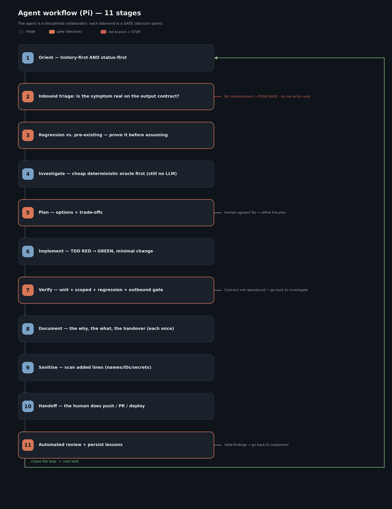

# The real working methodology — with Pi as the agent (§08, §11)

How the **same** 11-stage course methodology (born in Claude Code, carried to Cursor) runs with **Pi**
as the agent. Not an ideal template: the production flow, with the adapted surface (`AGENTS.md`,
`APPEND_SYSTEM.md`, skills, MCP, extensions). The method is unchanged; only the surface moves.

| File | What it is |
|---|---|
| [`WORKFLOW.md`](./WORKFLOW.md) | The 11 stages + two-level memory, with Pi tools. |
| [`REAL_EXAMPLE.md`](./REAL_EXAMPLE.md) | A concrete case (empty field) through the 11 stages. |
| [`tools.md`](./tools.md) | Prevalence: CodeGraph, Serena, Playwright, skill `kg`, oracles. |
| [`machine-sync.md`](./machine-sync.md) | Ops runbook (tarball bring-up + evolution to S3); Pi adaptation note at the top. |
| [`s3-sync/`](./s3-sync/) | The shared-record scripts (genericised but real). Start from `config.env.example`. |
| [`tools/`](./tools/) | **Two real read-only tools**, genericised, with offline tests: a Jira/Confluence client that only sends GET (plus the one write path, to Confluence, with a human OK per page) and the evidence-capture core (which S3 version a run actually used). |
| [`../../docs/synchro/s3-sync/README.md`](../../docs/synchro/s3-sync/README.md) | Shared engineering record on S3 (sync vs mount, roles, identity, guard both directions). |
| [`../../docs/KNOWLEDGE_GRAPH.md`](../../docs/KNOWLEDGE_GRAPH.md) | Ticket graph (graphify) — same scripts; skill `kg` works unchanged in Pi. |
| [`../../docs/ai-agents-code-methodology/PI_ADAPTATION.md`](../../docs/ai-agents-code-methodology/PI_ADAPTATION.md) | Full adaptation pack (+ ready-to-copy `pi/` surface). |
| [`flow.png`](./flow.png) | Flow diagram (render: `uv run --with pillow python examples/methodology/render_flow.py`). |

## Central idea

> **The agent is a disciplined collaborator, not an autopilot. Autonomy is earned decision-by-decision.**

Deterministic gates (contract, oracle, tests, sanitise, human on externals) — same as in Claude Code
and Cursor. In Pi they matter *more*: Pi asks for no approval before any tool call, so the gates
are the only brakes besides your extensions and your container.

## Pi surface (what lives where)

| Role | Claude Code | Cursor | Pi |
|---|---|---|---|
| Always-on orientation | `CLAUDE.md` | `AGENTS.md` + `.cursor/rules/` | `AGENTS.md` (cwd + ancestors; one per directory) |
| Always-on gates | `CLAUDE.md` / rules | `.mdc` `alwaysApply` | `APPEND_SYSTEM.md` (`.pi/` or `~/.pi/agent/`) |
| Skills `kg`, sanitise… | `~/.claude/skills/` (`/kg`) | `.cursor/skills/` | `.pi/skills/`, `~/.pi/agent/skills/` (`/skill:kg`) |
| MCP | `.mcp.json` / `claude mcp add` | `.cursor/mcp.json` | `.pi/mcp.json` / `pi mcp add` — `toolExposure: direct` for the method's tools |
| Hard gates | hooks + allowlist | `.cursor/hooks.json` | **extension** `block-external-git.ts` ([TESTED]) + container |
| Plan gate | Plan mode | Plan mode | **none built in** — plan file + human OK (or `plan-mode/` example) |
| External handoff | human | human (rules/hooks block push) | human (global extension blocks push) |

## How it fits with the tools

- **GSD** ([`../gsd/`](../gsd/)) — **Claude Code only**; in Pi use plan files + prompt templates.
- **Skill `kg`** — same graphify scripts; ports unchanged. **`kg-refresh`** needs subagents for the
  semantic-extraction step — Pi has none built in (extension, or keep that step in Claude Code).
- **CodeGraph / Serena / Playwright / Context7** — MCP in `.pi/mcp.json` ([`../mcp/`](../mcp/)).
- **Docker** — outbound in the deployed image (same).

## Portability

Starter kit: [`../../docs/ai-agents-code-methodology/`](../../docs/ai-agents-code-methodology/)
(`PI_ADAPTATION.md` + the `pi/` surface).
