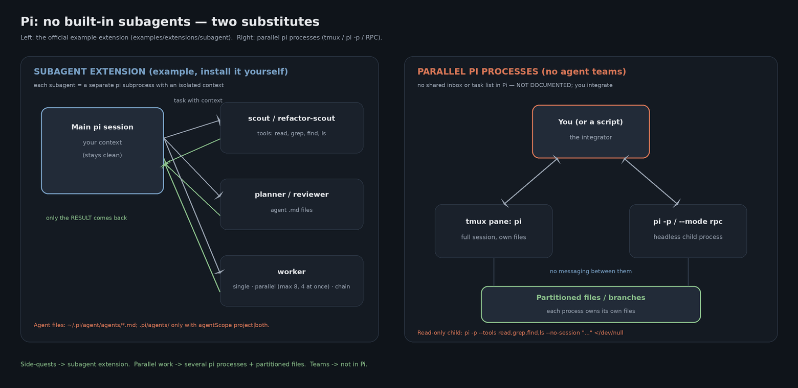

# Subagents in Pi — not built in, by design (§06)

Pi's README and homepage: Pi "ships with powerful defaults but **skips features like sub-agents and
plan mode**". Under *What we didn't build*: **"No sub-agents — Spawn Pi instances via tmux, or build
your own with extensions, or install a package."** So in Pi a subagent is something you *add*.



(`agents.png` is rendered offline with Pillow: `uv run --with pillow python examples/subagents/render_agents.py`;
editable source `agents.mmd`.)

## 1. The official example extension — `examples/extensions/subagent/` in the Pi repo

Source: <https://github.com/earendil-works/pi/tree/main/packages/coding-agent/examples/extensions/subagent>.

- Each subagent is a **separate `pi` subprocess** with an isolated context; only its result returns.
- Modes: single `{agent, task}` · parallel `{tasks:[…]}` (max 8, 4 concurrent) · chain `{chain:[…]}`
  with a `{previous}` placeholder.
- Agent definitions are Markdown with frontmatter **`name`, `description`, `tools`, `model`**.
- Locations: `~/.pi/agent/agents/*.md` always; `.pi/agents/*.md` **only** with
  `agentScope: "project" | "both"`.
- Shipped samples: `scout` (read, grep, find, ls, bash; Haiku), `planner`, `reviewer`, `worker`; workflow
  prompts `/implement`, `/scout-and-plan`, `/implement-and-review`.
- Install: copy or symlink the folder into `~/.pi/agent/extensions/subagent/`.

This folder ships two agent files in that format, ported from the course's prompt templates:

| File | Role |
|---|---|
| [`agents/refactor-scout.md`](./agents/refactor-scout.md) | CodeGraph → Serena → grep before any rename/delete; verdict SAFE/RISKY/STOP |
| [`agents/security-reviewer.md`](./agents/security-reviewer.md) | Read-only security review with severity + minimal fix |

Both use `tools: read, grep, find, ls` — a **read-only** subagent is simply an agent file without
`bash`, `edit` or `write`. Note the shipped `scout` *does* include `bash`. Copy them to
`~/.pi/agent/agents/` (or `.pi/agents/` with `agentScope` set).

> Untested here: these two files were written against the documented format, not run under the
> extension. Whether a child process sees your MCP servers depends on your setup — verify.

## 2. Without any extension: a disposable read-only child process

Documented flags only:

```bash
pi -p --tools read,grep,find,ls --no-session "List every caller of parse_header and its file" </dev/null
```

`--tools` with plain names **replaces** the default tool set (since 1.1.0; `+x`/`-x` entries adjust
instead, and the two kinds cannot be mixed). `</dev/null` avoids the [TESTED] hang when stdin is a
non-TTY pipe that never closes.

## 3. Agent teams — not in Pi

No agent teams, no shared inbox or task list: **NOT DOCUMENTED** anywhere in Pi. The substitute:

1. Several `pi` processes in **tmux** panes (Pi's own suggestion), or parallel `pi -p` / `pi --mode rpc`
   children driven by a script.
2. **Partition the files** (or branches): each process owns its own.
3. You (or the orchestrating script) integrate the results.

## 4. [3rd-party] packages — untested

- `pi-subagents` (nicobailon; "single-agent delegation and scripted multi-agent workflows") and its fork
  `@schovest/pi-subagents`. Try once with `pi -e npm:pi-subagents`, install with `pi install npm:…`.

## 5. Subagent or parallel processes?

| | Subagent extension | Parallel pi processes |
|---|---|---|
| Built in? | No — example extension or package | Yes — it is just `pi` |
| Context | Isolated; result returns to the parent | Each a full session |
| Coordination | Parent session orchestrates (single / parallel / chain) | You or a script; no messaging |
| Ideal for | Side-quests, scouting, review | Independent work streams on partitioned files |

**Methodology link:** `refactor-scout` encodes the CodeGraph → Serena order (Part 2). GSD packaged
similar roles as Claude Code agents; in Pi they live as agent files + prompt templates
([`../gsd/`](../gsd/)).
